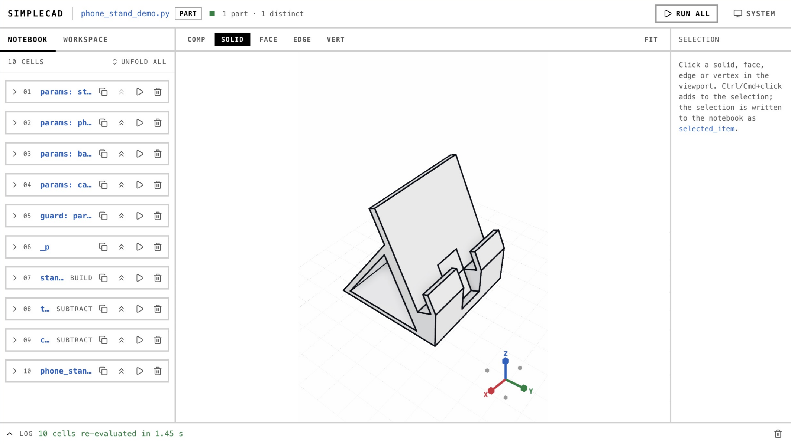

# AICG Projects

## Introduction

AICG Projects extends [CG-projects](https://github.com/syby119/CG-projects) with assignments in computer graphics and AI for Graphics. The curriculum has two traditional rendering projects and two AI-focused projects. Students implement core graphics techniques from first principles, then explore how learned models can support modeling and scene reconstruction.

The traditional rendering projects cover:

- Rasterization on the CPU and GPU.
- Ray tracing on the CPU and GPU.

The AI for Graphics projects cover:

- Turning natural-language requests into editable CAD models with an agent that checks and revises its results.
- Reconstructing a self-captured scene with 3D Gaussian Splatting (3D-GS), then planning and simulating robot navigation within it.

Each project calls for visual inspection and measurable tests of its results.

## Clone the repository

```sh
git clone https://github.com/syby119/AICG-projects.git
cd AICG-projects
```

## Projects

<table width="100%">
  <thead>
    <tr>
      <th width="50%"><a href="projects/project1/README.md">Project 1: Software Renderer</a></th>
      <th width="50%"><a href="projects/project2/README.md">Project 2: Ray Tracing</a></th>
    </tr>
  </thead>
  <tbody>
    <tr>
      <td width="50%"></td>
      <td width="50%"></td>
    </tr>
    <tr>
      <td width="50%">Implement and compare CPU and GPU rasterizers, including clipping, triangle coverage, depth testing, and perspective-correct interpolation.</td>
      <td width="50%">Implement CPU and GPU ray tracers that share scene data and progressively accumulate full-image samples.</td>
    </tr>
  </tbody>
</table>

<table width="100%">
  <thead>
    <tr>
      <th width="50%"><a href="projects/project3/README.md">Project 3: CAD Agent</a></th>
      <th width="50%"><a href="projects/project4/README.md">Project 4: 3DGS Navigation</a></th>
    </tr>
  </thead>
  <tbody>
    <tr>
      <td width="50%"></td>
      <td width="50%"></td>
    </tr>
    <tr>
      <td width="50%">Use SimpleCADAPI to turn clarified natural-language requests into verified, editable, and exportable CAD models.</td>
      <td width="50%">Reconstruct a self-captured real scene, plan multiple collision-free routes, and simulate a robot following the selected route.</td>
    </tr>
  </tbody>
</table>

Projects 1 and 2 are independent CMake applications. Each requires Git, CMake 3.20 or newer, a C++20 compiler and standard library with `std::format`, an OpenGL 4.1 capable graphics environment, and [vcpkg](https://github.com/microsoft/vcpkg) for its dependencies. Configure and build them separately; there is no repository-wide build. Their linked guides provide setup commands and runtime controls.

Projects 3 and 4 provide assignment specifications and example images. Their guides cover the required workflow, validation, and submissions.
