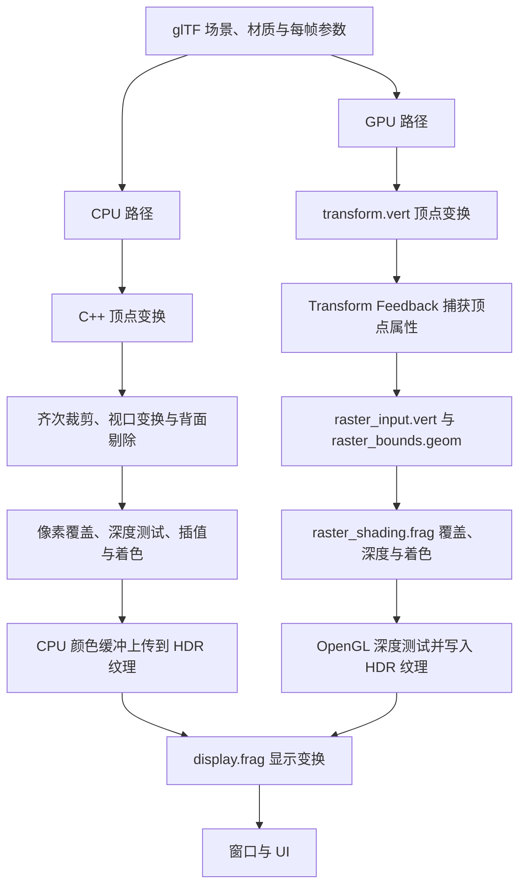

# Project 1：软件渲染器

[English](README.md) | 简体中文

本作业面向本科计算机图形学课程，内容为光栅化渲染管线的实现，核心算法包括齐次裁剪、视口变换、三角形覆盖测试、深度测试和透视正确插值。

本作业要求分别完成 CPU 和 GPU 两套实现。CPU 版使用 C++，GPU 版使用 GLSL。两套实现分别验证，并在相同的场景、相机、材质和光源条件下进行结果对比。程序界面支持在运行时切换渲染实现。

默认场景为 Damaged Helmet。两套实现均需渲染具有纹理材质和方向光照的旋转模型。界面提供光源颜色与强度控制。


## 目录

- [1. 学习目标与预备知识](#1-学习目标与预备知识)
- [2. 环境配置与编译运行](#2-环境配置与编译运行)
- [3. 运行界面与操作](#3-运行界面与操作)
- [4. 工程结构](#4-工程结构)
- [5. 渲染管线与数据约定](#5-渲染管线与数据约定)
- [6. 作业任务](#6-作业任务)
- [7. 纹理材质与显示](#7-纹理材质与显示)
- [8. 调试与验证](#8-调试与验证)
- [9. 实验报告与提交建议](#9-实验报告与提交建议)
- [10. 可选扩展](#10-可选扩展)
- [11. 常见问题](#11-常见问题)
- [12. 模型资源与许可](#12-模型资源与许可)

## 1. 学习目标与预备知识

本作业的学习目标包括：

1. 解释模型、世界、观察、裁剪、NDC 和屏幕坐标之间的关系。
2. 在透视除法之前，使用 Sutherland–Hodgman 算法裁剪三角形。
3. 使用边函数计算像素覆盖与重心坐标，并正确处理三角形朝向。
4. 使用深度缓冲解决遮挡，区分深度插值和一般顶点属性的插值。
5. 对位置、法线和 UV 进行透视正确插值，调用材质着色函数生成像素颜色。
6. 对照 CPU 与 GPU 实现，定位某个错误属于管线中的哪一阶段。

预备知识包括向量点积与叉积、齐次坐标、矩阵乘法、透视投影、重心坐标和基本纹理映射。编程基础包括 C++ 的 `std::vector`、`std::array` 和类定义，以及 GLSL 的输入输出、`uniform`、向量与矩阵运算。

框架提供窗口管理、OpenGL 资源封装、模型加载、交互界面和材质着色。

## 2. 环境配置与编译运行

### 2.1 所需环境

| 项目 | 要求或用途 |
| --- | --- |
| Git | 获取仓库和 vcpkg |
| CMake | 3.20 或更新版本 |
| C++ 工具链 | 支持 C++20，且标准库提供 `std::format`；Windows 可使用 Visual Studio 2022 的 C++ 工具链 |
| 图形环境 | 能创建 OpenGL 4.1 Core 上下文的驱动与桌面环境 |
| vcpkg | 根据本项目的清单安装第三方依赖 |

第三方依赖记录在 [`vcpkg.json`](vcpkg.json)：GLAD、GLFW、GLM、tinygltf、stb 和 Dear ImGui。它们分别负责 OpenGL 函数加载、窗口、数学计算、glTF 解析、图像解码和交互界面。

两条路径均需要 OpenGL 上下文。CPU 路径将颜色缓冲上传为纹理进行显示。程序启动时初始化两套渲染器并编译 GPU 着色器。

以下命令均从**仓库根目录**执行，即包含 `base/`、`projects/` 和 `screenshots/` 的目录。项目依赖根目录下的共享代码，请保留整个仓库结构。

### 2.2 Windows：PowerShell + Visual Studio 2022

安装 Visual Studio 时，选择“使用 C++ 的桌面开发”，并安装相应的 MSVC 工具链与 Windows SDK。

如果尚未安装 vcpkg，在仓库根目录执行：

```powershell
git clone https://github.com/microsoft/vcpkg.git vcpkg
.\vcpkg\bootstrap-vcpkg.bat
$vcpkgRoot = (Resolve-Path .\vcpkg).Path
```

如果已有 vcpkg，将 `$vcpkgRoot` 设置为它的实际目录，随后配置、构建并运行：

```powershell
cmake -S projects/project1 -B build/project1 -G "Visual Studio 17 2022" -A x64 "-DCMAKE_TOOLCHAIN_FILE=$vcpkgRoot/scripts/buildsystems/vcpkg.cmake"
cmake --build build/project1 --config Release --target software_renderer
.\build\project1\Release\software_renderer.exe
```

配置过程通过 vcpkg 自动安装清单中的依赖。首次配置包含依赖下载与编译。

若希望使用 Visual Studio 调试，可打开生成的 `build/project1/software_renderer.sln`，将 `software_renderer` 设为启动项目。使用 Debug 配置时，可执行文件位于对应的 `Debug/` 目录；比较性能时使用 Release。

### 2.3 macOS / Linux：终端

准备支持所需 C++20 标准库功能的编译器、CMake，以及平台所需的构建工具；Linux 还需具备 GLFW 所需的窗口系统开发依赖。若已有 vcpkg，可替换下方工具链路径。

```sh
git clone https://github.com/microsoft/vcpkg.git vcpkg
./vcpkg/bootstrap-vcpkg.sh

cmake -S projects/project1 -B build/project1 \
  -DCMAKE_BUILD_TYPE=Release \
  -DCMAKE_TOOLCHAIN_FILE="$PWD/vcpkg/scripts/buildsystems/vcpkg.cmake"
cmake --build build/project1 --target software_renderer --parallel
./build/project1/software_renderer
```

上述输出路径适用于单配置生成器。使用多配置生成器时，需要指定 `--config Release`，并在相应配置子目录寻找程序。macOS 的窗口创建代码会请求前向兼容的 OpenGL 上下文。

### 2.4 修改代码和着色器后如何更新

修改 C++ 后，重新执行构建命令即可。修改 shader 后，建议按“**保存 → 构建 → 重启程序**”的顺序验证。

构建目标会调用 [`cmake/sync_assets.cmake`](cmake/sync_assets.cmake)，在可执行文件旁生成 `assets/`：模型等非 shader 文件会被复制，shader 优先通过硬链接同步，无法建立硬链接时改为复制。有些编辑器保存文件时会替换原文件，此时旧硬链接可能不再指向新的源文件，因此仍需重新构建以刷新资源。

Shader 源文件位于 `assets/shaders/`，在程序启动时加载。修改后需同步运行资源并重启程序。

## 3. 运行界面与操作

默认窗口为 `1280 × 720`，初始使用 CPU 路径。模型绕世界 Y 轴自动旋转，相机位于 `(0, 0, 3.6)`，默认视场角为 45°，近、远裁剪面分别为 `0.1` 和 `100`。

| 操作或界面项 | 作用 |
| --- | --- |
| `CPU` | 使用 C++ 软件渲染路径 |
| `GPU fragment` | 使用 GPU 路径 |
| `light color` | 修改方向光颜色 |
| `light intensity` | 调整方向光强度，范围为 `0–20` |
| 窗口标题中的 FPS | 观察整个应用的帧率 |
| `Esc` | 退出程序 |

当前没有鼠标相机控制、暂停按钮或命令行模型选择参数，默认窗口也不可拖动调整大小。需要修改相机、固定模型姿态或更换模型时，可从 [`software_renderer_app.cpp`](src/software_renderer_app.cpp) 的初始化与 `renderFrame()` 入手；窗口参数位于 [`main.cpp`](src/main.cpp)。

CPU/GPU 对比使用相同的模型姿态、相机、灯光和分辨率。固定姿态可通过将 `sceneFrame.model` 中依赖 `getTotalTime()` 的旋转角替换为常数实现。

## 4. 工程结构

```text
仓库根目录/
├── base/                         窗口、相机、变换与 OpenGL 资源封装
├── screenshots/project1.png      运行示例
└── projects/project1/
    ├── CMakeLists.txt            构建入口
    ├── vcpkg.json                依赖清单
    ├── cmake/sync_assets.cmake   运行资源同步脚本
    ├── docs/images/              README 插图
    ├── include/                  数据类型与类声明
    ├── src/                      C++ 实现
    └── assets/
        ├── models/               glTF 模型与许可说明
        └── shaders/              顶点、几何、片元及显示着色器
```

| 文件 | 职责 |
| --- | --- |
| [`src/software_renderer_app.cpp`](src/software_renderer_app.cpp) | 场景初始化、每帧输入、渲染路径切换、最终显示 |
| [`include/raster_types.h`](include/raster_types.h) | `ClipVertex`、`FrameState`、`DrawItem`、`PbrMaterial` |
| [`include/mesh.h`](include/mesh.h) | 顶点与索引结构，以及 GPU 输入缓存 |
| [`src/cpu_renderer.cpp`](src/cpu_renderer.cpp) | CPU 顶点变换、裁剪、屏幕三角形生成和逐像素计算 |
| [`src/gpu_renderer.cpp`](src/gpu_renderer.cpp) | Transform Feedback、材质绑定、帧缓冲与两次绘制的调度 |
| [`assets/shaders/transform.vert`](assets/shaders/transform.vert) | GPU 顶点变换与 Transform Feedback 输出 |
| [`assets/shaders/raster_input.vert`](assets/shaders/raster_input.vert) | 将捕获的顶点属性传递到几何阶段 |
| [`assets/shaders/raster_bounds.geom`](assets/shaders/raster_bounds.geom) | 裁剪、屏幕转换与候选片元区域生成 |
| [`assets/shaders/raster_shading.frag`](assets/shaders/raster_shading.frag) | 覆盖测试、深度、属性插值与 PBR |
| [`include/pbr_shading.h`](include/pbr_shading.h) | CPU 端材质着色函数 |
| [`src/cpu_sampler.cpp`](src/cpu_sampler.cpp)、[`src/cpu_texture2d.cpp`](src/cpu_texture2d.cpp) | 纹理寻址、过滤、存储格式转换与 mipmap |
| [`src/raster_scene.cpp`](src/raster_scene.cpp) | glTF 场景、节点变换、材质和纹理加载 |
| [`assets/shaders/display.frag`](assets/shaders/display.frag) | HDR 输出的色调映射与显示变换 |

应用主循环连接公共数据结构、CPU 管线、GPU shader 和材质系统。OpenGL 资源封装位于 `base/`。

## 5. 渲染管线与数据约定

### 5.1 两条路径如何对应



GPU 路径中，几何着色器生成覆盖候选区域的图元，片元着色器根据原三角形进行覆盖测试，并计算深度和属性。OpenGL 负责候选图元的硬件光栅化、片元生成、深度比较和缓冲写入。

Transform Feedback 将第一次顶点处理的输出写入缓冲，第二次绘制再把这些记录作为输入。捕获的顺序为 `tfClip`、`tfWorldPosition`、`tfNormal`、`tfUv`，对应 C++ 的 `ClipVertex`，共 48 字节。若改动字段布局，需要同时检查 C++ 偏移、捕获变量和顶点属性配置。

### 5.2 坐标空间

项目采用列向量形式，顶点位置按以下顺序变换：

```text
p_world = M · p_local
p_view  = V · p_world
p_clip  = P · V · M · p_local
```

`FrameState.model` 已包含当前帧的整体模型变换和该绘制项沿场景节点层级累积的变换。非均匀缩放下，法线使用 `transpose(inverse(mat3(M)))` 变换。

| 阶段 | 本项目的约定 |
| --- | --- |
| 齐次裁剪空间 | 保留 `-w ≤ x, y, z ≤ w` 的区域 |
| NDC | 裁剪后用 `xyz / w` 得到，正常可见范围为 `[-1, 1]` |
| 屏幕坐标 | 原点在左下角，X 向右、Y 向上，尺寸使用实际 framebuffer 像素数 |
| 像素采样点 | 像素 `(x, y)` 的中心是 `(x + 0.5, y + 0.5)` |
| 深度 | `z_ndc * 0.5 + 0.5`，范围为 `[0, 1]`，越小越近 |
| 三角形朝向 | 屏幕空间有向面积为正时保留，即逆时针正面 |

### 5.3 关键中间数据

| 数据 | 包含什么 | 用在何处 |
| --- | --- | --- |
| `Vertex` | 模型空间位置、法线和 UV | 原始网格输入 |
| `ClipVertex` | 裁剪坐标、世界位置、法线和 UV | 顶点变换后与裁剪阶段 |
| `ScreenVertex` | 屏幕位置、深度、`1/w` 与待插值属性 | 屏幕三角形阶段 |
| `ScreenTriangle`（CPU） | 三个屏幕顶点、切线和副切线 | CPU 逐像素计算 |
| `FrameState` | 变换矩阵、相机、方向光和目标尺寸 | 两条路径共享的帧输入 |
| `DrawItem` | 网格、材质和节点累积变换 | 一次场景绘制 |

`screenAndInvW.xy` 存储屏幕位置，`.z` 存储映射后的深度，`.w` 存储裁剪空间 `w` 的倒数。

每帧只清空一次颜色和深度缓冲，随后绘制所有 `DrawItem`，最后显示结果。若在每个绘制项之前清屏，前面物体的颜色和遮挡关系都会丢失。

## 6. 作业任务

### 6.1 任务范围

本作业包含**第一部分：CPU 光栅化器**和**第二部分：GPU 光栅化器**，两部分均为必做。每套实现分别完成裁剪、屏幕转换、覆盖测试、深度计算、属性插值和着色。

任务位置由 `TODO` 标记。框架提供 CPU 顶点变换、纹理工具、CPU/GPU 的 PBR 函数和 OpenGL 调度代码。

第 6.2、6.3 节分别列出两套实现的任务，第 6.4–6.9 节说明对应算法。

### 6.2 第一部分：CPU 光栅化器（必做）

在 [`src/cpu_renderer.cpp`](src/cpu_renderer.cpp) 中完成以下 CPU 任务：

| 任务 | 位置 | 实现要求 |
| --- | --- | --- |
| CPU-1. 齐次裁剪 | `clipAgainst()` | 实现 Sutherland–Hodgman 裁剪，插值生成交点属性 |
| CPU-2. 屏幕三角形生成 | `buildScreenTriangles()` | 对裁剪多边形进行三角化，映射到屏幕空间，保留深度和 `1/w`，构造切线基，并剔除背面与退化三角形 |
| CPU-3. 覆盖测试与重心坐标 | `rasterizeTriangles()` | 使用边函数测试像素中心，计算屏幕重心坐标 |
| CPU-4. 深度测试 | `rasterizeTriangles()` | 插值窗口深度，与 CPU 深度缓冲比较并更新可见样本 |
| CPU-5. 属性插值与着色 | `rasterizeTriangles()` | 透视正确地插值世界位置、法线和 UV，调用 `pbrShade()`，写入 CPU 颜色缓冲 |

CPU 顶点变换由已有的 `transformVertices()` 提供。CPU 光栅化器在 C++ 中计算颜色和可见性，框架将其颜色缓冲上传为 OpenGL 纹理进行显示。

**第一部分验收：** 选择 `CPU`，验证场景渲染、裁剪、遮挡和纹理插值。单独记录 CPU 结果。

### 6.3 第二部分：GPU 光栅化器（必做）

在 GLSL 着色器中完成以下 GPU 任务：

| 任务 | 位置 | 实现要求 |
| --- | --- | --- |
| GPU-1. 顶点变换 | `transform.vert::main` | 为 Transform Feedback 计算裁剪坐标、世界位置、变换后的法线与 UV |
| GPU-2. 齐次裁剪 | `raster_bounds.geom::clipAgainst` | 使用 GLSL 实现裁剪和交点属性插值 |
| GPU-3. 屏幕三角形生成 | `raster_bounds.geom::main` | 将裁剪多边形的扇形三角形转换到屏幕空间，保留深度和 `1/w`，剔除背面与退化三角形 |
| GPU-4. 候选图元生成 | `raster_bounds.geom::main` | 确定候选像素范围，在几何着色器输出限制内发射覆盖图元 |
| GPU-5. 覆盖测试与重心坐标 | `raster_shading.frag::main` | 根据原屏幕三角形测试覆盖，丢弃外部片元并计算重心坐标 |
| GPU-6. 深度输出 | `raster_shading.frag::main` | 插值窗口深度并写入 `gl_FragDepth`，由 OpenGL 进行深度比较 |
| GPU-7. 属性插值与着色 | `raster_shading.frag::main` | 计算透视正确的属性、构造切线基、调用 GLSL 的 `pbrShade()` 并输出颜色 |

[`src/gpu_renderer.cpp`](src/gpu_renderer.cpp) 已提供 Transform Feedback 和绘制阶段调度，`raster_input.vert` 将捕获记录传给几何阶段。GPU 版在这些着色阶段完成自身的光栅化计算，并写入自身的帧缓冲输出。

**第二部分验收：** 选择 `GPU fragment`，执行与第一部分相同的检查，并在固定模型姿态下对比 CPU/GPU 的轮廓、遮挡、UV 和光照。

### 6.4 算法说明：顶点变换

在 GPU 顶点阶段计算裁剪空间位置、世界空间位置、变换后的法线，并传递 UV。使用 CPU 的 `transformVertices()` 检查矩阵顺序和字段含义。

此阶段应保留齐次坐标。透视除法发生在裁剪之后，而世界位置、法线和 UV 需要继续传递给后续阶段。

检查点：模型位置和大小正确；模型旋转时表面光照随世界法线变化；材质纹理保持附着在表面。

### 6.5 算法说明：齐次空间裁剪

对三角形依次使用六个裁剪平面。对于平面 `plane`，以 `dot(plane, vertex.clip) ≥ 0` 表示顶点位于保留侧。

Sutherland–Hodgman 算法遍历多边形的每一条有向边，包括“最后一个顶点 → 第一个顶点”：

| 前一顶点 | 当前顶点 | 输出 |
| --- | --- | --- |
| 内 | 内 | 当前顶点 |
| 内 | 外 | 边与平面的交点 |
| 外 | 内 | 交点、当前顶点 |
| 外 | 外 | 不输出 |

交点参数由两个端点的平面侧值求出，裁剪位置与其余属性使用同一插值参数。法线在裁剪阶段保持线性插值，在像素着色阶段归一化。

这里处理的是凸多边形。三角形经过六个平面裁剪后最多有 9 个顶点，因此 CPU 和 GPU 都使用固定容量的临时数组。裁剪后少于 3 个顶点则没有可绘制三角形；其余情况按 `(0, 1, 2)`、`(0, 2, 3)` 等组成三角形扇。

检查点：完全在外的三角形消失；跨越近裁剪面的三角形保留可见部分；裁剪交点处 UV 和光照连续。对边界上的顶点，还应留意重复顶点和退化三角形。

### 6.6 算法说明：屏幕转换与候选区域

对裁剪后的顶点进行透视除法，并完成视口映射：

```text
invW     = 1 / clip.w
ndc      = clip.xyz * invW
screen.x = (ndc.x * 0.5 + 0.5) * width
screen.y = (ndc.y * 0.5 + 0.5) * height
depth    = ndc.z * 0.5 + 0.5
```

保留 `invW`，以便后续进行透视正确插值。根据屏幕空间有向面积剔除背面和零面积三角形，并由世界位置边与 UV 差构造切线、副切线。UV 行列式接近零时，需要保留或设计合理的退化处理。

CPU 路径只遍历限制在目标尺寸内的三角形包围盒。GPU 路径需要发射能覆盖候选像素的图元，再由片元阶段筛选出原三角形内部的像素。

当前几何着色器对每个扇形三角形发射一个覆盖其包围矩形的大直角三角形，并向外扩展一个像素的候选范围，以避免候选图元自身的边界规则漏掉采样点。最多 7 个扇形三角形、每个输出 3 个顶点，因此声明 `max_vertices = 21`。这些候选图元的顶点可以超出 NDC 可见范围，OpenGL 会继续裁剪它们。

检查点：注意屏幕 Y 轴方向、面积符号、包围盒边界和几何着色器的输出上限。包围盒是加速和候选生成手段，不能代替原三角形的覆盖测试。

### 6.7 算法说明：覆盖测试与重心坐标

使用二维边函数判断像素中心是否位于三角形内部。对已统一为正面积的三角形，三个边函数的符号可以直接用于内部测试；再除以三角形有向面积，得到屏幕重心坐标 `λ0`、`λ1`、`λ2`。

应满足：三角形顶点处对应权重为 1，内部权重非负，权重之和约为 1。CPU 使用 `(x + 0.5, y + 0.5)`，GPU 使用 `gl_FragCoord.xy`。

覆盖测试包含边函数为零的样本。共享边样本的唯一归属需要额外的边界规则，例如在两套实现中一致应用 top-left 规则。

### 6.8 算法说明：深度测试

使用屏幕重心坐标对三个顶点的窗口深度进行线性插值：

```text
z = λ0 * z0 + λ1 * z1 + λ2 * z2
```

CPU 深度缓冲每帧初始化为 `1.0`，新片元深度严格小于已有值时才更新颜色和深度。GPU 片元着色器将计算结果写入 `gl_FragDepth`，由 OpenGL 完成与深度缓冲的比较。

`z0`、`z1`、`z2` 为已映射到 `[0, 1]` 的窗口深度，其屏幕空间插值不使用其他属性所需的透视权重修正。

检查点：前方表面遮挡后方表面；交换两个不共面的重叠三角形的绘制顺序，可见结果应保持一致；不同 `DrawItem` 之间仍共享遮挡关系。

### 6.9 算法说明：透视正确插值与像素着色

世界位置、法线和 UV 等属性需要使用经过 `1/w` 修正的权重：

```text
q_i = λ_i * invW_i
weight_i = q_i / (q_0 + q_1 + q_2)
attribute = weight_0 * attribute_0
          + weight_1 * attribute_1
          + weight_2 * attribute_2
```

用插值后的世界位置、法线、UV，以及三角形的切线和副切线调用 `pbrShade()`。法线插值后需要归一化，当前 PBR 函数中包含这一步。

GPU 中的 `gScreenAndInvW`、`gWorld`、`gNormal` 和 `gUv` 使用 `flat` 将原屏幕三角形的完整数据传递给候选片元。属性插值使用原三角形的重心坐标。

检查点：用倾斜的棋盘格平面观察 UV，比较屏幕线性插值与透视正确插值的差异；确认深度保持使用上一节的屏幕重心坐标。

## 7. 纹理材质与显示

### 7.1 纹理采样

`CpuTexture2D` 负责像素存储、格式转换和 mip 链，`CpuSampler` 负责寻址和过滤。两者分开后，同一份像素数据可以配合不同采样策略使用。

CPU 采样器已有最近邻、双线性过滤，以及 Repeat、MirroredRepeat、ClampToEdge 三种寻址模式。`sampleMipMap()` 支持显式 LOD 和 mip 层间混合；`sample()` 则固定采样基础层，并使用 `minFilter`，不会根据屏幕导数自动计算 LOD。

默认场景使用基础层纹理、双线性过滤和 Repeat 寻址。GPU 使用 `textureLod(..., 0.0)` 采样，场景加载时不生成 mipmap。

若研究双线性过滤，注意纹素中心对应的坐标偏移：`x = u * width - 0.5`、`y = v * height - 0.5`。边界附近的四个纹素要分别按寻址模式处理，负 UV 也需要测试。

### 7.2 PBR 材质

CPU 的 [`pbr_shading.h`](include/pbr_shading.h) 与 GPU 的 [`raster_shading.frag`](assets/shaders/raster_shading.frag) 提供对应的 metallic-roughness 着色逻辑，包含 GGX 分布、Smith 几何项和 Schlick Fresnel 近似。光栅化阶段向这些函数提供插值后的表面属性。

| 槽位 | 内容 | 处理方式 |
| --- | --- | --- |
| 0：BaseColor | 基础色 | RGB 从 sRGB 解码到线性空间，再乘材质因子 |
| 1：MetallicRoughness | G 为粗糙度，B 为金属度 | 作为线性数据，分别乘对应因子 |
| 2：Normal | 切线空间法线 | 从 `[0, 1]` 映射到 `[-1, 1]`，经 TBN 转到世界空间 |
| 3：Occlusion | R 为遮蔽值 | 当前实现将其按强度应用到直接光结果 |
| 4：Emissive | 自发光 | RGB 解码到线性空间，乘因子后叠加 |

光照模型使用一个方向光，不包含环境光照或阴影贴图。自发光贡献独立于光源强度。遮蔽贴图在本实现中调制直接光照结果。

### 7.3 最终显示

两条路径输出到 `RGBA16F` HDR 纹理，CPU 路径在显示前上传颜色缓冲，GPU 路径直接写入帧缓冲的颜色附件。统一的 `display.frag` 随后执行：

```text
color = color / (color + 1)   // 色调映射
color = pow(color, 1 / 2.2)   // 近似显示 gamma 变换
```

像素数值对比使用相同管线阶段和颜色空间的数据。截图数值已经包含色调映射与显示变换。

## 8. 调试与验证

### 8.1 按阶段调试

先固定模型和相机，再逐步增加复杂度：常量颜色 → 覆盖与深度 → 重心坐标可视化 → UV 可视化 → 法线可视化 → 完整材质。

中间结果可视化包括将重心权重输出为 RGB、将 UV 坐标映射为颜色，以及使用 `normal * 0.5 + 0.5` 显示法线。

### 8.2 建议测试场景

下列场景用于检查各管线阶段，需要构造相应的测试几何。

每个场景都应分别检查 CPU 和 GPU 两套实现，记录相同输入下的 CPU 结果、GPU 结果及差异。

| 场景 | 主要检查内容 | 期望现象 |
| --- | --- | --- |
| 单个正面三角形 | 面积、像素中心、覆盖测试 | 内部连续、边界位置合理 |
| 反转顶点顺序 | 背面剔除 | 三角形被剔除 |
| 三点共线 | 退化处理 | 不产生有效片元，不除以零 |
| 三角形完全位于一个裁剪面外 | 裁剪清空 | 没有可见输出 |
| 三角形分别跨越六个裁剪面 | 交点与属性 | 可见部分保留，边界稳定 |
| 两个不同深度的重叠三角形 | 深度测试 | 近处遮挡远处，交换顺序后结果一致 |
| 两个独立绘制项相互遮挡 | 每帧清屏时机 | 深度在绘制项之间保留 |
| 倾斜棋盘格平面 | 透视正确 UV | 远近缩放符合透视关系 |
| 共享边的两个三角形 | 边界规则 | 检查裂缝与重复覆盖 |
| 退化 UV、非均匀模型缩放 | TBN 与法线变换 | 无异常亮点、NaN 或不合理光照 |

CPU/GPU 验证覆盖轮廓、遮挡、纹理映射和数值差异。浮点运算、边界精度和 HDR 存储可能产生局部偏差。几何缺失、错误遮挡、纹理扭曲和持续闪烁属于需要进一步定位的错误。

### 8.3 性能记录

性能对比应固定 Release 配置、分辨率、模型、相机、材质和灯光，记录 CPU、GPU 型号及编译器。默认启用垂直同步，窗口标题显示的是整帧 FPS，包含界面、资源上传和显示等待，不能直接当作光栅化内核的耗时。

CPU 路径逐像素执行材质采样与着色。性能优化需进行正确性验证，并在相同条件下记录修改前后的结果。

## 9. 实验报告与提交建议

实验报告建议包含以下内容：

1. **运行环境**：系统、CPU/GPU、编译器、构建配置与分辨率。
2. **完成情况**：分开列出第一部分（CPU-1–CPU-5）和第二部分（GPU-1–GPU-7）的修改文件、完成内容和已知问题。
3. **关键算法**：用自己的语言解释裁剪、覆盖测试、深度与透视正确插值，并说明坐标约定。
4. **结果证据**：分别提供两套实现的结果，包括固定姿态下的 CPU/GPU 截图和裁剪、遮挡、UV 等针对性测试，并对比、解释差异。
5. **调试分析**：记录错误现象、定位依据与修复方式。
6. **性能与扩展**：如做了优化，提供同条件对比；引用外部代码、资料或工具辅助时说明来源和使用范围。

算法分析问题：

- 为什么要在透视除法之前裁剪？跨越近裁剪面时直接除以 `w` 会怎样？
- 为什么深度可以按屏幕重心坐标插值，而 UV 需要 `1/w` 修正？
- GPU 已能产生片元，本项目为什么仍在片元着色器里测试原三角形的覆盖？
- 如果每个绘制项都清空深度缓冲，会出现什么现象？
- 如何构造一个能暴露裁剪交点属性插值问题的小场景？

可复现性检查包括从干净的构建目录配置项目、检查源码与运行资源完整性，以及核对提交版本、构建命令和报告结果的一致性。构建产物、本地依赖仓库和 IDE 缓存与项目源码分别管理。

## 10. 可选扩展

可选扩展方向包括：

- **完善边界覆盖**：实现一致的 top-left 规则，检查共享边是否只归属一个三角形。
- **完善纹理采样**：验证寻址模式和过滤，扩展到基于导数的 LOD、mipmap 与三线性过滤；特别测试奇数尺寸、`1×N` 和 `N×1` 纹理。
- **优化 CPU 路径**：尝试增量边函数、分块、SIMD 或多线程，并验证颜色与深度写入的正确性。
- **增加调试界面**：增加暂停旋转、固定角度、显示深度/法线/UV 或同步比较两条路径的功能。
- **增强鲁棒性**：处理退化几何、退化 TBN、接近零的 `w` 和非有限数值。
- **扩展场景与光照**：增加测试模型、更多光源或环境光照，并明确新增功能的支持范围。

纹理扩展需分别验证初始存储、格式转换和边缘滤波。

## 11. 常见问题

| 现象 | 排查方向 |
| --- | --- |
| 找不到 `glad`、`glfw3`、`glm`、`imgui` 等依赖 | 确认首次配置时传入正确的 vcpkg 工具链路径；若改换工具链或生成器，使用新的构建目录重新配置 |
| 找不到 `tiny_gltf_v3.h` | 确认使用本项目清单安装依赖；当前代码需要该头文件提供的 API，仅安装其他版本头文件未必兼容 |
| `std::format` 编译失败 | 核对实际使用的编译器及标准库是否支持该功能；仅指定 C++20 编译选项还不够 |
| 找不到源码或 `base/` | 检查是否保留完整仓库结构；命令中的 `-S projects/project1` 从仓库根目录解析 |
| 依赖下载或构建失败 | 先读配置输出与 vcpkg 日志，区分网络、平台开发包缺失和编译器问题 |
| OpenGL / GLFW 初始化失败 | 检查驱动和当前运行环境能否提供 OpenGL 4.1 Core；虚拟机、远程桌面或无桌面环境需单独核对 |
| 找不到模型或 shader | 检查可执行文件旁的 `assets/models/` 与 `assets/shaders/`；重新构建资源目标，移动程序时携带资源目录 |
| shader 编译或链接错误 | 查看终端日志，检查 GLSL 版本、阶段输入输出、数组声明和几何阶段输出限制；启动时两条路径的 shader 都会加载 |
| 改了 shader 但画面没变化 | 确认修改源目录，重新构建以刷新硬链接或副本，再重启程序 |
| 模型完全消失 | 检查 MVP 顺序、六个平面的符号、`w`、屏幕面积符号与深度范围 |
| 有轮廓但材质扭曲 | 检查 UV、透视修正权重、`1/w` 存储和纹理寻址 |
| 光照异常或局部闪烁 | 检查法线变换、裁剪属性、零向量归一化、退化 UV 和 TBN |
| GPU 正常但 CPU 明显更慢 | 先确认使用 Release，并区分正确性问题与逐像素着色的成本 |
| 更换 glTF 后加载失败 | 当前加载器只覆盖部分 glTF 功能；网格需包含 POSITION、NORMAL、TEXCOORD_0，使用三角形 primitive；纹理加载按当前代码支持的嵌入形式准备 |

程序会将异常信息输出到标准错误。遇到启动后立即退出，建议从终端运行，以便保留错误日志。

## 12. 模型资源与许可

默认模型位于 [`assets/models/DamagedHelmet.gltf`](assets/models/DamagedHelmet.gltf)，路径由 `software_renderer_app.cpp` 中的 `kModelPath` 指定。目录还包含用于检查场景节点层级变换的 `HierarchyTest.gltf`。

随附模型的许可信息见 [`assets/models/LICENSE.md`](assets/models/LICENSE.md)。使用、修改或分发模型及纹理时，请保留相应许可与署名信息。
