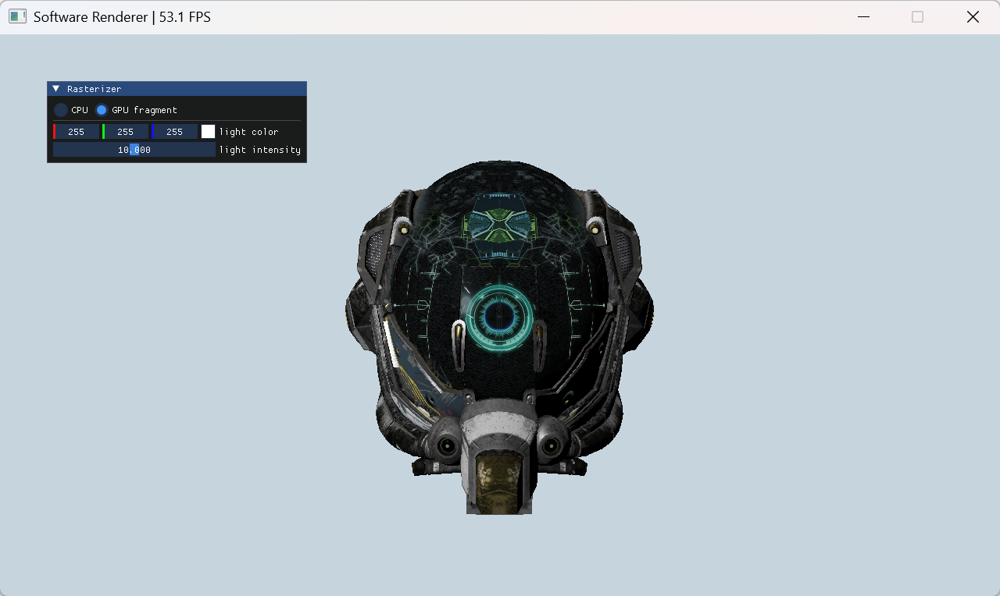
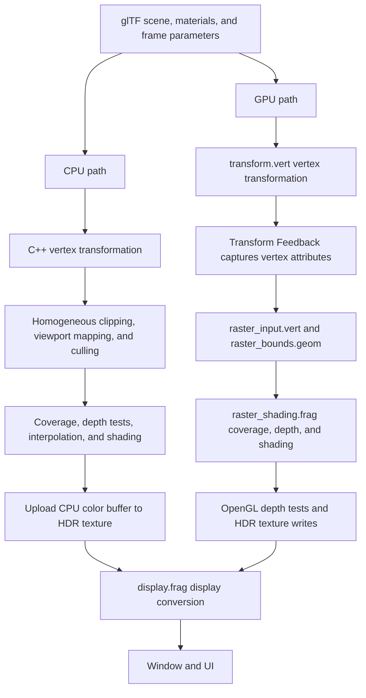

# Project 1: Software Renderer

English | [简体中文](README-zh.md)

This assignment covers the implementation of a rasterization pipeline in an undergraduate computer graphics course. The core algorithms include homogeneous clipping, viewport transformation, triangle coverage tests, depth tests, and perspective-correct interpolation.

The assignment requires separate CPU and GPU implementations. The CPU implementation uses C++, and the GPU implementation uses GLSL. Both implementations are validated individually and compared using the same scene, camera, materials, and light. The interface supports switching between them at runtime.

The default scene is Damaged Helmet. Both implementations render the rotating model with textured materials and directional lighting. The interface provides controls for light color and intensity.



## Contents

- [1. Learning Objectives and Prerequisites](#1-learning-objectives-and-prerequisites)
- [2. Setup, Build, and Run](#2-setup-build-and-run)
- [3. Interface and Controls](#3-interface-and-controls)
- [4. Project Structure](#4-project-structure)
- [5. Rendering Pipeline and Data Conventions](#5-rendering-pipeline-and-data-conventions)
- [6. Assignment Tasks](#6-assignment-tasks)
- [7. Textures, Materials, and Display](#7-textures-materials-and-display)
- [8. Debugging and Validation](#8-debugging-and-validation)
- [9. Report and Submission Suggestions](#9-report-and-submission-suggestions)
- [10. Optional Extensions](#10-optional-extensions)
- [11. Troubleshooting](#11-troubleshooting)
- [12. Model Assets and Licensing](#12-model-assets-and-licensing)

## 1. Learning Objectives and Prerequisites

The learning objectives are:

1. Explain the relationships among model, world, view, clip, normalized device, and screen coordinates.
2. Clip triangles before perspective division using the Sutherland–Hodgman algorithm.
3. Use edge functions to determine pixel coverage and barycentric coordinates, with consistent triangle winding.
4. Resolve visibility using a depth buffer and distinguish depth interpolation from the interpolation of other vertex attributes.
5. Interpolate positions, normals, and UVs with perspective correction, then supply them to a material shading function.
6. Compare the CPU and GPU implementations and identify which pipeline stage causes a rendering error.

Prerequisites include dot and cross products, homogeneous coordinates, matrix multiplication, perspective projection, barycentric coordinates, and basic texture mapping. Programming prerequisites include C++ classes, `std::vector`, and `std::array`, along with GLSL inputs, outputs, `uniform` variables, vectors, and matrices.

The framework provides window management, OpenGL resource wrappers, model loading, an interface, and material shading.

## 2. Setup, Build, and Run

### 2.1 Requirements

| Component | Requirement or purpose |
| --- | --- |
| Git | Obtain the repository and vcpkg |
| CMake | Version 3.20 or newer |
| C++ toolchain | C++20 support and a standard library that provides `std::format`; the Visual Studio 2022 C++ toolchain is suitable on Windows |
| Graphics environment | A driver and desktop environment capable of creating an OpenGL 4.1 Core context |
| vcpkg | Install third-party dependencies from the project manifest |

The dependencies in [`vcpkg.json`](vcpkg.json) are GLAD, GLFW, GLM, tinygltf, stb, and Dear ImGui. They provide OpenGL function loading, window management, math operations, glTF parsing, image decoding, and the interactive UI, respectively.

Both paths require an OpenGL context. The CPU path uploads its color buffer as a texture for display. The application initializes both renderers and compiles the GPU shaders at startup.

Run all commands below from the **repository root**, which contains `base/`, `projects/`, and `screenshots/`. Keep the full repository structure: this project depends on shared code outside `projects/project1/`.

### 2.2 Windows: PowerShell and Visual Studio 2022

When installing Visual Studio, select the **Desktop development with C++** workload, including the corresponding MSVC toolchain and Windows SDK.

If you do not have vcpkg, run the following from the repository root:

```powershell
git clone https://github.com/microsoft/vcpkg.git vcpkg
.\vcpkg\bootstrap-vcpkg.bat
$vcpkgRoot = (Resolve-Path .\vcpkg).Path
```

If you already have vcpkg, set `$vcpkgRoot` to its actual location. Then configure, build, and run:

```powershell
cmake -S projects/project1 -B build/project1 -G "Visual Studio 17 2022" -A x64 "-DCMAKE_TOOLCHAIN_FILE=$vcpkgRoot/scripts/buildsystems/vcpkg.cmake"
cmake --build build/project1 --config Release --target software_renderer
.\build\project1\Release\software_renderer.exe
```

Configuration installs the manifest dependencies automatically through vcpkg. The initial configuration includes dependency downloads and compilation.

To debug in Visual Studio, open the generated `build/project1/software_renderer.sln` and select `software_renderer` as the startup project. A Debug build places the executable in the corresponding `Debug/` directory. Use Release for performance comparisons.

### 2.3 macOS / Linux: Terminal

Prepare a compiler and standard library with the required C++20 features, CMake, and the build tools required by your platform. Linux also needs the window-system development dependencies required by GLFW. If you already have vcpkg, replace the toolchain path below with your installation's path.

```sh
git clone https://github.com/microsoft/vcpkg.git vcpkg
./vcpkg/bootstrap-vcpkg.sh

cmake -S projects/project1 -B build/project1 \
  -DCMAKE_BUILD_TYPE=Release \
  -DCMAKE_TOOLCHAIN_FILE="$PWD/vcpkg/scripts/buildsystems/vcpkg.cmake"
cmake --build build/project1 --target software_renderer --parallel
./build/project1/software_renderer
```

These output paths assume a single-configuration generator. With a multi-configuration generator, specify `--config Release` and look for the executable in the corresponding configuration subdirectory. On macOS, the window code requests a forward-compatible OpenGL context.

### 2.4 Updating Code and Shaders

After editing C++, run the build command again. After editing a shader, follow the sequence **save → build → restart the application**.

The build invokes [`cmake/sync_assets.cmake`](cmake/sync_assets.cmake) to populate an `assets/` directory beside the executable. Models and other non-shader assets are copied. Shaders are hard-linked to their source files when possible, with copying as a fallback. Some editors replace a file when saving it, which can leave an existing hard link pointing to the old file; rebuilding refreshes the runtime assets.

Shader source files are located in `assets/shaders/` and load at application startup. Changes require resource synchronization and an application restart.

## 3. Interface and Controls

The default window is `1280 × 720`, and the application starts with the CPU path. The model rotates automatically about the world Y axis. The camera starts at `(0, 0, 3.6)`, with a 45° field of view and near/far clipping distances of `0.1` and `100`.

| Control or display | Effect |
| --- | --- |
| `CPU` | Select the C++ software rendering path |
| `GPU fragment` | Select the GPU rendering path |
| `light color` | Change the directional light's color |
| `light intensity` | Adjust the light's intensity from `0–20` |
| FPS in the window title | Observe the frame rate of the whole application |
| `Esc` | Exit the application |

There are currently no mouse camera controls, pause button, or command-line model selection options, and the default window cannot be resized by dragging. To change the camera, fix the model pose, or load another model, start with initialization and `renderFrame()` in [`software_renderer_app.cpp`](src/software_renderer_app.cpp). Window settings are in [`main.cpp`](src/main.cpp).

CPU/GPU comparisons require an identical model pose, camera, light, and resolution. A fixed pose can be set by replacing the rotation angle based on `getTotalTime()` in `sceneFrame.model` with a constant.

## 4. Project Structure

```text
repository root/
├── base/                         Window, camera, transforms, and OpenGL wrappers
├── screenshots/project1.png      Runtime example
└── projects/project1/
    ├── CMakeLists.txt            Build entry point
    ├── vcpkg.json                Dependency manifest
    ├── cmake/sync_assets.cmake   Runtime asset synchronization
    ├── docs/images/              README illustrations
    ├── include/                  Data types and class declarations
    ├── src/                      C++ implementations
    └── assets/
        ├── models/               glTF models and licensing information
        └── shaders/              Vertex, geometry, fragment, and display shaders
```

| File | Responsibility |
| --- | --- |
| [`src/software_renderer_app.cpp`](src/software_renderer_app.cpp) | Scene initialization, frame inputs, path selection, and presentation |
| [`include/raster_types.h`](include/raster_types.h) | `ClipVertex`, `FrameState`, `DrawItem`, and `PbrMaterial` |
| [`include/mesh.h`](include/mesh.h) | Vertices, indices, and cached GPU inputs |
| [`src/cpu_renderer.cpp`](src/cpu_renderer.cpp) | CPU vertex transforms, clipping, screen triangles, and pixel processing |
| [`src/gpu_renderer.cpp`](src/gpu_renderer.cpp) | Transform Feedback, material binding, framebuffers, and the two draw passes |
| [`assets/shaders/transform.vert`](assets/shaders/transform.vert) | GPU vertex transformation and Transform Feedback outputs |
| [`assets/shaders/raster_input.vert`](assets/shaders/raster_input.vert) | Passing captured attributes to the geometry stage |
| [`assets/shaders/raster_bounds.geom`](assets/shaders/raster_bounds.geom) | Clipping, screen conversion, and candidate fragment generation |
| [`assets/shaders/raster_shading.frag`](assets/shaders/raster_shading.frag) | Coverage, depth, attribute interpolation, and PBR |
| [`include/pbr_shading.h`](include/pbr_shading.h) | CPU material shading |
| [`src/cpu_sampler.cpp`](src/cpu_sampler.cpp), [`src/cpu_texture2d.cpp`](src/cpu_texture2d.cpp) | Texture addressing, filtering, storage conversion, and mipmaps |
| [`src/raster_scene.cpp`](src/raster_scene.cpp) | Loading glTF scenes, node transforms, materials, and textures |
| [`assets/shaders/display.frag`](assets/shaders/display.frag) | Tone mapping and display conversion for HDR output |

The application loop connects the shared data structures, CPU pipeline, GPU shaders, and material system. OpenGL resource wrappers are located in `base/`.

## 5. Rendering Pipeline and Data Conventions

### 5.1 How the Two Paths Correspond



In the GPU path, the geometry shader emits primitives covering candidate regions. The fragment shader tests coverage against the original triangle and computes depth and attributes. OpenGL performs hardware rasterization of the candidate primitives, fragment generation, depth comparison, and buffer writes.

Transform Feedback writes the first vertex pass's outputs into a buffer, which becomes the input to the second draw pass. The captured fields are `tfClip`, `tfWorldPosition`, `tfNormal`, and `tfUv`, in that order. They match the C++ `ClipVertex` record, totaling 48 bytes. If you change the layout, check the C++ offsets, captured variables, and vertex attribute configuration together.

### 5.2 Coordinate Spaces

The project uses column vectors. Vertex positions are transformed in this order:

```text
p_world = M · p_local
p_view  = V · p_world
p_clip  = P · V · M · p_local
```

`FrameState.model` already combines the frame's overall model transform with the draw item's accumulated scene-node transform. Under nonuniform scaling, normals are transformed using `transpose(inverse(mat3(M)))`.

| Stage | Convention in this project |
| --- | --- |
| Homogeneous clip space | Keep the region `-w ≤ x, y, z ≤ w` |
| NDC | Compute `xyz / w` after clipping; the usual visible range is `[-1, 1]` |
| Screen space | Origin at the lower left, X to the right, Y upward; dimensions use physical framebuffer pixels |
| Pixel sample | The center of pixel `(x, y)` is `(x + 0.5, y + 0.5)` |
| Depth | `z_ndc * 0.5 + 0.5`, in `[0, 1]`; smaller values are closer |
| Triangle winding | Keep triangles with positive signed screen-space area: counterclockwise front faces |

### 5.3 Intermediate Data

| Type | Contents | Used for |
| --- | --- | --- |
| `Vertex` | Model-space position, normal, and UV | Original mesh input |
| `ClipVertex` | Clip coordinates, world position, normal, and UV | Vertex output and clipping |
| `ScreenVertex` | Screen position, depth, `1/w`, and attributes | Screen-space triangle processing |
| `ScreenTriangle` (CPU) | Three screen vertices, tangent, and bitangent | CPU pixel processing |
| `FrameState` | Transforms, camera, directional light, and target extent | Shared frame inputs |
| `DrawItem` | Mesh, material, and accumulated node transform | One scene draw |

`screenAndInvW.xy` stores screen position, `.z` stores mapped depth, and `.w` stores the reciprocal of clip-space `w`.

Clear the color and depth buffers once per frame, draw all `DrawItem` objects, then present the result. Clearing before each draw item would erase the colors and visibility information produced by earlier items.

## 6. Assignment Tasks

### 6.1 Scope

The assignment consists of **Part I: CPU Rasterizer** and **Part II: GPU Rasterizer**. Both parts are required. Each implementation performs clipping, screen conversion, coverage tests, depth calculation, attribute interpolation, and shading.

The task locations are identified by `TODO` markers. The framework provides CPU vertex transformation, texture utilities, CPU/GPU PBR functions, and OpenGL scheduling code.

Sections 6.2 and 6.3 list the tasks for each implementation. Sections 6.4–6.9 describe the corresponding algorithms.

### 6.2 Part I: CPU Rasterizer (Required)

Implement the CPU tasks in [`src/cpu_renderer.cpp`](src/cpu_renderer.cpp):

| Task | Location | Required work |
| --- | --- | --- |
| CPU-1. Homogeneous clipping | `clipAgainst()` | Implement Sutherland–Hodgman clipping and interpolate intersection attributes |
| CPU-2. Screen triangle generation | `buildScreenTriangles()` | Triangulate the clipped polygon, map to screen space, retain depth and `1/w`, construct tangent axes, and cull back faces and degenerate triangles |
| CPU-3. Coverage and barycentric coordinates | `rasterizeTriangles()` | Test pixel centers with edge functions and compute screen-space barycentric coordinates |
| CPU-4. Depth tests | `rasterizeTriangles()` | Interpolate window depth, compare with the CPU depth buffer, and update visible samples |
| CPU-5. Attribute interpolation and shading | `rasterizeTriangles()` | Interpolate world position, normal, and UV with perspective correction, call `pbrShade()`, and write the CPU color buffer |

`transformVertices()` supplies CPU vertex transformation. The CPU rasterizer computes colors and visibility in C++; the framework uploads its color buffer to an OpenGL texture for presentation.

**Part I validation:** Select `CPU` and verify the rendered scene, clipping, visibility, and texture interpolation. Record CPU results separately from GPU results.

### 6.3 Part II: GPU Rasterizer (Required)

Implement the GPU tasks in the GLSL shaders:

| Task | Location | Required work |
| --- | --- | --- |
| GPU-1. Vertex transformation | `transform.vert::main` | Compute clip coordinates, world position, transformed normal, and UV for Transform Feedback |
| GPU-2. Homogeneous clipping | `raster_bounds.geom::clipAgainst` | Implement clipping and intersection attribute interpolation in GLSL |
| GPU-3. Screen triangle generation | `raster_bounds.geom::main` | Convert the clipped polygon's fan triangles to screen space, retain depth and `1/w`, and cull back faces and degenerate triangles |
| GPU-4. Candidate primitive generation | `raster_bounds.geom::main` | Bound candidate pixels and emit covering primitives within geometry shader output limits |
| GPU-5. Coverage and barycentric coordinates | `raster_shading.frag::main` | Test against the original screen triangle, discard outside fragments, and compute barycentric coordinates |
| GPU-6. Depth output | `raster_shading.frag::main` | Interpolate window depth and write `gl_FragDepth`; OpenGL performs the depth comparison |
| GPU-7. Attribute interpolation and shading | `raster_shading.frag::main` | Compute perspective-correct attributes, construct tangent axes, call the GLSL `pbrShade()`, and output color |

[`src/gpu_renderer.cpp`](src/gpu_renderer.cpp) supplies Transform Feedback and draw-pass scheduling, while `raster_input.vert` passes the captured records to the geometry stage. The GPU implementation performs its own rasterization calculations in these shader stages and writes its own framebuffer output.

**Part II validation:** Select `GPU fragment` and run the same checks used for Part I. Compare CPU/GPU silhouettes, visibility, UVs, and lighting at a fixed model pose.

### 6.4 Algorithm Notes: Vertex Transformation

In the GPU vertex stage, compute the clip-space position, world-space position, and transformed normal, and pass through the UV. Compare with the CPU `transformVertices()` function to check matrix order and field meanings.

Preserve homogeneous coordinates at this stage. Perspective division happens after clipping, while world position, normal, and UV must remain available to later stages.

Check that the model has the expected position and size, lighting responds to its world-space normals as it rotates, and textures remain attached to the surface.

### 6.5 Algorithm Notes: Homogeneous Clipping

Clip each triangle against the six planes in sequence. For a plane `plane`, `dot(plane, vertex.clip) ≥ 0` means the vertex lies in the retained half-space.

Sutherland–Hodgman visits every directed polygon edge, including the closing edge from the last vertex to the first:

| Previous vertex | Current vertex | Emit |
| --- | --- | --- |
| Inside | Inside | Current vertex |
| Inside | Outside | Edge-plane intersection |
| Outside | Inside | Intersection, then current vertex |
| Outside | Outside | Nothing |

The endpoints' signed plane values determine the intersection parameter. Clip position and other attributes use the same interpolation parameter. Normals are interpolated linearly during clipping and normalized during pixel shading.

The polygon remains convex. A triangle clipped against six planes has at most nine vertices, so both implementations use fixed-capacity scratch arrays. Fewer than three surviving vertices produce no triangles. Otherwise, triangulate the polygon as a fan: `(0, 1, 2)`, `(0, 2, 3)`, and so on.

Check that fully outside triangles disappear, triangles crossing the near plane retain their visible portions, and UVs and lighting remain continuous at intersections. Also watch for duplicate boundary vertices and degenerate triangles.

### 6.6 Algorithm Notes: Screen Conversion and Candidate Regions

Apply perspective division to the clipped vertices, then map them to the viewport:

```text
invW     = 1 / clip.w
ndc      = clip.xyz * invW
screen.x = (ndc.x * 0.5 + 0.5) * width
screen.y = (ndc.y * 0.5 + 0.5) * height
depth    = ndc.z * 0.5 + 0.5
```

Keep `invW` for perspective-correct interpolation. Use signed screen-space area to reject back-facing and zero-area triangles. Construct the tangent and bitangent from world-space edges and UV differences, with a fallback or other appropriate handling when the UV determinant is close to zero.

The CPU scans only the triangle's bounding box, clamped to the render target. The GPU emits primitives covering candidate samples and lets the fragment stage select those inside the original triangle.

The current geometry shader emits one large right triangle covering each fan triangle's bounding rectangle. It expands the candidate bounds by one pixel to avoid losing samples to the candidate primitive's own edge rules. Up to seven fan triangles emit three vertices each, hence `max_vertices = 21`. Candidate vertices may extend outside the visible NDC range; OpenGL clips these generated primitives afterward.

Check the screen Y direction, signed area, bounding limits, and geometry shader output limits. A bounding region accelerates candidate generation; the original triangle still needs a coverage test.

### 6.7 Algorithm Notes: Coverage and Barycentric Coordinates

Use 2D edge functions to determine whether a pixel center lies inside a triangle. With all surviving triangles having positive area, the three edge signs provide the inside test. Divide by the signed triangle area to obtain screen-space barycentric coordinates `λ0`, `λ1`, and `λ2`.

At a vertex, its corresponding weight should be one. Inside the triangle, weights should be nonnegative and sum to approximately one. The CPU samples at `(x + 0.5, y + 0.5)`; the GPU uses `gl_FragCoord.xy`.

The coverage test includes samples with a zero edge-function value. Unique ownership of shared-edge samples requires an additional boundary rule, such as top-left, applied consistently in both implementations.

### 6.8 Algorithm Notes: Depth Tests

Interpolate the vertices' window-space depths linearly using screen-space barycentric coordinates:

```text
z = λ0 * z0 + λ1 * z1 + λ2 * z2
```

The CPU depth buffer starts at `1.0` each frame. Update depth and color only when a new fragment is strictly closer than the stored depth. The GPU fragment shader writes its computed depth to `gl_FragDepth`, and OpenGL compares it with the depth buffer.

The values `z0`, `z1`, and `z2` are window-space depths mapped to `[0, 1]`. Their screen-space interpolation does not require the perspective weight correction used for other attributes.

Check that nearer surfaces occlude farther ones. Reversing the draw order of overlapping triangles at distinct depths should preserve visibility, including across different `DrawItem` objects.

### 6.9 Algorithm Notes: Perspective-Correct Interpolation and Shading

Interpolate world position, normal, UV, and similar attributes using weights corrected by `1/w`:

```text
q_i = λ_i * invW_i
weight_i = q_i / (q_0 + q_1 + q_2)
attribute = weight_0 * attribute_0
          + weight_1 * attribute_1
          + weight_2 * attribute_2
```

Pass the interpolated world position, normal, and UV, together with the triangle's tangent and bitangent, to `pbrShade()`. Normalize normals after interpolation; the supplied PBR function includes this step.

On the GPU, `gScreenAndInvW`, `gWorld`, `gNormal`, and `gUv` use `flat` interpolation to deliver the original screen triangle's complete data to each candidate fragment. Attribute interpolation uses the original triangle's barycentric coordinates.

Use a tilted checkerboard plane to compare affine and perspective-correct UV interpolation. Confirm that depth still uses the screen-space barycentric coordinates described in the previous section.

## 7. Textures, Materials, and Display

### 7.1 Texture Sampling

`CpuTexture2D` manages pixel storage, format conversion, and mip levels. `CpuSampler` handles addressing and filtering. Separating them allows the same pixel data to be sampled with different settings.

The CPU sampler provides nearest and bilinear filtering, with Repeat, MirroredRepeat, and ClampToEdge addressing. `sampleMipMap()` supports explicit LOD and blending between mip levels. `sample()` always samples the base level using `minFilter`; it does not compute LOD automatically from screen-space derivatives.

The default scene uses the base level, bilinear filtering, and Repeat addressing. The GPU samples with `textureLod(..., 0.0)`. Scene loading does not generate mipmaps.

When studying bilinear filtering, account for texel centers: `x = u * width - 0.5` and `y = v * height - 0.5`. Resolve the four neighboring texels individually using the selected addressing mode, and test negative UV coordinates as well.

### 7.2 PBR Materials

The CPU [`pbr_shading.h`](include/pbr_shading.h) and GPU [`raster_shading.frag`](assets/shaders/raster_shading.frag) provide corresponding metallic-roughness shading, including the GGX distribution, Smith geometry term, and Schlick Fresnel approximation. The rasterization stages supply the interpolated surface attributes to these functions.

| Slot | Contents | Treatment |
| --- | --- | --- |
| 0: BaseColor | Base color | Decode RGB from sRGB to linear space and multiply by the material factor |
| 1: MetallicRoughness | Roughness in G, metallic in B | Treat as linear data and multiply by the corresponding factors |
| 2: Normal | Tangent-space normal | Remap from `[0, 1]` to `[-1, 1]` and transform to world space through TBN |
| 3: Occlusion | Occlusion value in R | The current implementation applies it to direct lighting with the configured strength |
| 4: Emissive | Emissive color | Decode RGB to linear space, multiply by the factor, and add to the result |

The lighting model uses one directional light, with no environment lighting or shadow maps. Emissive contribution is independent of light intensity. The occlusion map modulates the direct-light result in this implementation.

### 7.3 Final Display

Both paths output to an `RGBA16F` HDR texture. The CPU uploads its color buffer before presentation, while the GPU writes directly to a framebuffer color attachment. The shared `display.frag` then applies:

```text
color = color / (color + 1)   // Tone mapping
color = pow(color, 1 / 2.2)   // Approximate display gamma conversion
```

Pixel comparisons use data from the same pipeline stage and color space. Screenshot values include tone mapping and display conversion.

## 8. Debugging and Validation

### 8.1 Debug One Stage at a Time

Fix the model and camera first, then increase complexity gradually: constant color → coverage and depth → barycentric visualization → UV visualization → normal visualization → full materials.

Intermediate visualizations include barycentric weights as RGB, UV coordinates as colors, and normals mapped with `normal * 0.5 + 0.5`.

### 8.2 Suggested Test Scenes

The following scenes provide targeted checks for individual pipeline stages. They require additional test geometry.

Apply the checks to the CPU and GPU implementations separately. For each scene, record the CPU result, the GPU result, and any differences under identical inputs.

| Scene | Main check | Expected behavior |
| --- | --- | --- |
| One front-facing triangle | Area, pixel centers, and coverage | Continuous interior with reasonable boundaries |
| Reversed vertex order | Back-face culling | Triangle is culled |
| Three collinear vertices | Degenerate geometry | No valid fragments or division by zero |
| Triangle fully outside one clip plane | Empty clipping result | No visible output |
| Triangle crossing each of the six clip planes | Intersections and attributes | Visible portions survive with stable boundaries |
| Two overlapping triangles at distinct depths | Depth tests | Nearer triangle wins regardless of draw order |
| Occluding geometry in separate draw items | Frame clearing | Depth information persists between draws |
| Tilted checkerboard plane | Perspective-correct UVs | Texture scaling follows perspective |
| Two triangles sharing an edge | Boundary rules | Inspect for cracks and duplicate coverage |
| Degenerate UVs and nonuniform model scaling | TBN and normal transforms | No abnormal bright spots, NaNs, or invalid lighting |

CPU/GPU validation covers silhouettes, visibility, texture mapping, and numerical differences. Floating-point arithmetic, boundary precision, and HDR storage may produce local deviations. Missing geometry, incorrect occlusion, distorted textures, and persistent flickering indicate errors requiring further investigation.

### 8.3 Recording Performance

Keep the Release configuration, resolution, model, camera, material, and light fixed. Record your CPU, GPU, and compiler. Vertical synchronization is enabled by default, and the title-bar FPS covers the entire frame, including the UI, uploads, and presentation waits. It is not a direct timing measurement of the rasterization kernel.

The CPU path performs texture sampling and shading per pixel. Optimization measurements require correctness validation and before-and-after results under identical conditions.

## 9. Report and Submission Suggestions

Suggested report contents:

1. **Environment:** Operating system, CPU/GPU, compiler, build configuration, and resolution.
2. **Completion status:** List Part I (CPU-1–CPU-5) and Part II (GPU-1–GPU-7) separately, with modified files, completed features, and known issues for each implementation.
3. **Algorithms:** Explain clipping, coverage, depth, and perspective-correct interpolation in your own words, including coordinate conventions.
4. **Evidence:** Provide results for each implementation, including CPU/GPU screenshots at a fixed pose and targeted tests for clipping, occlusion, UVs, and other relevant behavior. Include a comparison and explain any differences.
5. **Debugging analysis:** Document observed errors, diagnostic evidence, and corrections.
6. **Performance and extensions:** Give controlled comparisons for optimizations. Identify external code, references, and tool assistance, including how they were used.

Algorithm analysis topics:

- Why must clipping happen before perspective division? What happens if you divide by `w` directly when a triangle crosses the near plane?
- Why can depth use screen-space barycentric interpolation while UVs need correction by `1/w`?
- Given that the GPU already generates fragments, why does this project still test coverage against the original triangle in the fragment shader?
- What happens if the depth buffer is cleared before every draw item?
- How would you construct a small scene that exposes an attribute interpolation error at clipping intersections?

Reproducibility checks include configuration from a clean build directory, complete source and runtime assets, and consistency between the submitted version, build commands, and reported results. Generated build output, local dependency checkouts, and IDE caches are separate from project source files.

## 10. Optional Extensions

Optional extension topics:

- **Consistent boundary coverage:** Implement a top-left rule and verify that each shared-edge sample belongs to exactly one triangle.
- **Texture sampling:** Validate addressing and filtering, then add derivative-based LOD, mipmaps, and trilinear filtering. Include odd-sized, `1×N`, and `N×1` textures.
- **CPU optimization:** Try incremental edge functions, tiling, SIMD, or multithreading, while checking color and depth write correctness.
- **Debugging controls:** Add pause, fixed-angle controls, depth/normal/UV views, or synchronized comparisons between rendering paths.
- **Robustness:** Handle degenerate geometry and TBN frames, near-zero `w`, and non-finite values.
- **Scenes and lighting:** Add test models, more lights, or environment lighting, and state the supported scope of each new feature.

Texture extensions require separate validation of initial storage, format conversion, and edge filtering.

## 11. Troubleshooting

| Symptom | What to check |
| --- | --- |
| Missing `glad`, `glfw3`, `glm`, `imgui`, or similar packages | Pass the correct vcpkg toolchain path during initial configuration. Use a new build directory when changing toolchains or generators |
| Missing `tiny_gltf_v3.h` | Install dependencies using this project's manifest. The code requires the API in that header; another version's headers may not be compatible |
| `std::format` fails to compile | Check the actual compiler and standard library. Selecting C++20 alone does not supply missing library support |
| Missing sources or `base/` | Keep the complete repository structure. The documented `-S projects/project1` path is relative to the repository root |
| Dependency download or build fails | Read CMake output and vcpkg logs to distinguish network problems, missing platform development packages, and compiler failures |
| OpenGL / GLFW initialization fails | Check whether the driver and current environment provide OpenGL 4.1 Core. Verify virtual machines, remote desktops, and headless environments separately |
| Missing model or shader | Check `assets/models/` and `assets/shaders/` beside the executable. Rebuild the asset target, and keep assets with the executable when moving it |
| Shader compilation or linking fails | Read terminal logs. Check GLSL versions, stage interfaces, array declarations, and geometry output limits. Both paths' shaders load at startup |
| Shader edits do not change the image | Edit the source directory, rebuild to refresh links or copies, and restart the application |
| Model disappears entirely | Check MVP order, clip-plane signs, `w`, signed screen area, and depth range |
| Silhouette appears but textures are distorted | Check UVs, perspective weights, reciprocal `w` storage, and addressing |
| Lighting is invalid or flickers locally | Check normal transforms, clipping attributes, normalization of zero vectors, degenerate UVs, and TBN |
| GPU looks correct but CPU is much slower | Confirm a Release build and distinguish rendering errors from per-pixel shading costs |
| Another glTF model fails to load | The loader supports a subset of glTF. Meshes need POSITION, NORMAL, and TEXCOORD_0 and must use triangle primitives. Prepare textures in an embedded form supported by the current loader |

Exceptions are printed to standard error. If the application exits immediately, run it from a terminal so that you can read the error message.

## 12. Model Assets and Licensing

The default model is [`assets/models/DamagedHelmet.gltf`](assets/models/DamagedHelmet.gltf), selected by `kModelPath` in `software_renderer_app.cpp`. The directory also contains `HierarchyTest.gltf` for inspecting scene-node transforms.

See [`assets/models/LICENSE.md`](assets/models/LICENSE.md) for the bundled model's licensing information. Preserve the applicable license and attribution information when using, modifying, or redistributing models and textures.
