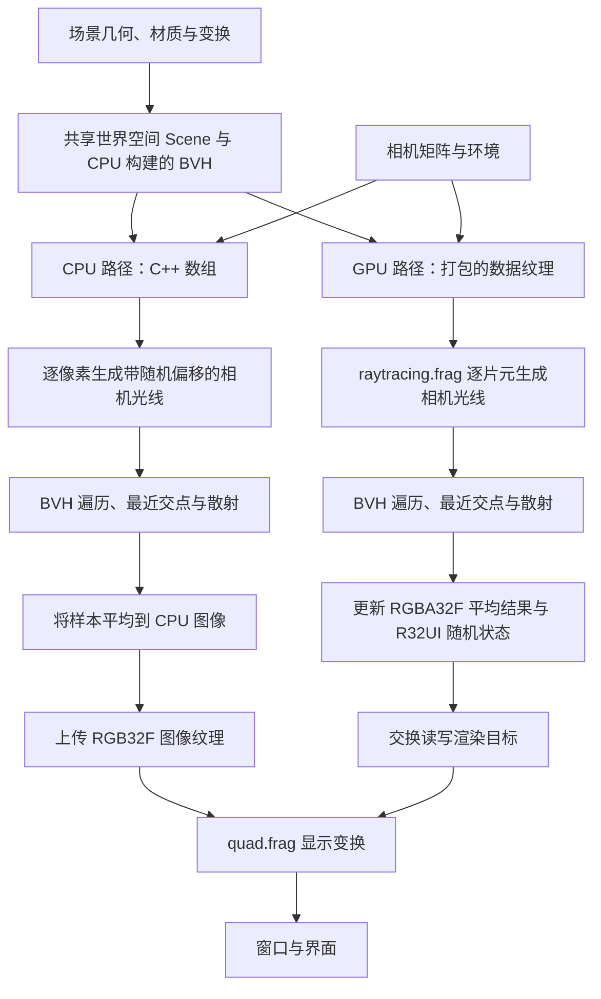

# Project 2：光线追踪

[English](README.md) | 简体中文

本作业面向本科计算机图形学课程，要求实现光线追踪管线。核心算法包括光线与球体、三角形的求交，轴对齐包围盒测试，层次包围盒（BVH）遍历，以及漫反射、金属和电介质材质的随机散射。

本作业要求分别完成 CPU 和 GPU 两套实现。CPU 版使用 C++，GPU 版使用 GLSL。两套实现分别验证，并在相同的场景、相机、材质、环境、分辨率和采样数条件下进行结果对比。程序界面支持在运行时切换渲染实现。

程序提供三个场景，从三个材质测试球体逐步扩展到包含大量球体和三个 Lucy 模型实例的场景。每条渲染路径在每个渲染帧中为每个像素增加一个路径样本，并逐帧更新平均结果。


## 目录

- [1. 学习目标与先修知识](#1-学习目标与先修知识)
- [2. 环境配置、构建与运行](#2-环境配置构建与运行)
- [3. 界面与操作](#3-界面与操作)
- [4. 项目结构](#4-项目结构)
- [5. 渲染管线与数据约定](#5-渲染管线与数据约定)
- [6. 作业任务](#6-作业任务)
- [7. 采样、材质与显示](#7-采样材质与显示)
- [8. 调试与验证](#8-调试与验证)
- [9. 实验报告与提交建议](#9-实验报告与提交建议)
- [10. 可选扩展](#10-可选扩展)
- [11. 常见问题](#11-常见问题)
- [12. 模型资源与许可](#12-模型资源与许可)

## 1. 学习目标与先修知识

学习目标包括：

1. 从带有像素内随机偏移的采样位置生成世界空间相机光线，解释逆投影和逆视图变换的作用。
2. 求出球体或三角形的最近有效交点，保持交点位置、法线和材质索引的一致性。
3. 利用 slab 测试和显式遍历栈，通过 BVH 加速求交。
4. 为 Lambertian、金属和电介质表面生成散射光线，处理反射、折射、Fresnel 反射率与全内反射。
5. 逐帧累积独立路径样本，区分采样噪声与几何、材质错误。
6. 分别验证 CPU 和 GPU 实现，再比较其几何、材质、收敛表现与性能。

先修知识包括向量运算、矩阵变换、光线参数方程、二次方程、重心坐标、反射与折射、概率密度和基本 Monte Carlo 估计。编程基础包括 C++ 类与容器、GLSL 函数和 `inout` 参数、纹理采样及帧缓冲附件。

框架提供窗口管理、相机控制、OBJ 加载、场景组织、BVH 构建、随机采样辅助函数、渐进累积和图像显示。

## 2. 环境配置、构建与运行

### 2.1 环境要求

| 组件 | 要求或用途 |
| --- | --- |
| Git | 获取仓库与 vcpkg |
| CMake | 3.20 或更新版本 |
| C++ 工具链 | 支持 C++20，标准库提供 `std::format`；Windows 可使用 Visual Studio 2022 C++ 工具链 |
| 图形环境 | 驱动和桌面环境能够创建 OpenGL 4.1 Core 上下文 |
| vcpkg | 按项目清单安装第三方依赖 |

[`vcpkg.json`](vcpkg.json) 中的依赖包括 GLAD、GLFW、GLM、tinyobjloader、stb 和 Dear ImGui，分别用于 OpenGL 函数加载、窗口管理、数学运算、OBJ 解析、图像解码和交互界面。

两条渲染路径都需要 OpenGL 上下文。CPU 路径会将累积图像上传为纹理以供显示。启动时会初始化两套渲染器、Lucy 模型和全部六张环境图像，即使初始场景只包含球体。

以下命令均从**仓库根目录**执行，该目录包含 `base/`、`projects/` 和 `screenshots/`。请保留完整仓库结构，本项目依赖 `projects/project2/` 以外的公共代码。

### 2.2 Windows：PowerShell 与 Visual Studio 2022

安装 Visual Studio 时，选择“**使用 C++ 的桌面开发**”工作负载，并安装相应的 MSVC 工具链与 Windows SDK。

如果尚未安装 vcpkg，在仓库根目录执行：

```powershell
git clone https://github.com/microsoft/vcpkg.git vcpkg
.\vcpkg\bootstrap-vcpkg.bat
$vcpkgRoot = (Resolve-Path .\vcpkg).Path
```

如果已经安装 vcpkg，将 `$vcpkgRoot` 设置为实际安装路径，再配置、构建并运行：

```powershell
cmake -S projects/project2 -B build/project2 -G "Visual Studio 17 2022" -A x64 "-DCMAKE_TOOLCHAIN_FILE=$vcpkgRoot/scripts/buildsystems/vcpkg.cmake"
cmake --build build/project2 --config Release --target ray_tracer
.\build\project2\Release\ray_tracer.exe
```

配置时 vcpkg 会自动安装清单中的依赖。首次配置包含依赖下载与编译过程。

在 Visual Studio 中调试时，打开生成的 `build/project2/ray_tracer.sln`，将 `ray_tracer` 设为启动项目。Debug 构建的可执行文件位于相应的 `Debug/` 目录。性能对比使用 Release 配置。

### 2.3 macOS / Linux：终端

准备具备所需 C++20 特性的编译器与标准库、CMake，以及平台所需的构建工具。Linux 还需要 GLFW 所依赖的窗口系统开发包。如果已有 vcpkg，请将下方工具链路径替换为实际安装路径。

```sh
git clone https://github.com/microsoft/vcpkg.git vcpkg
./vcpkg/bootstrap-vcpkg.sh

cmake -S projects/project2 -B build/project2 \
  -DCMAKE_BUILD_TYPE=Release \
  -DCMAKE_TOOLCHAIN_FILE="$PWD/vcpkg/scripts/buildsystems/vcpkg.cmake"
cmake --build build/project2 --target ray_tracer --parallel
./build/project2/ray_tracer
```

上述输出路径基于单配置生成器。使用多配置生成器时，需要指定 `--config Release`，并在对应配置子目录中查找可执行文件。macOS 下窗口代码会请求前向兼容的 OpenGL 上下文。

### 2.4 更新代码与 Shader

修改 C++ 后重新执行构建命令。修改 shader 后，按“**保存 → 构建 → 重启程序**”的顺序操作。

每次构建 `ray_tracer` 都会运行 `ray_tracer_assets` 目标，调用 [`cmake/sync_assets.cmake`](cmake/sync_assets.cmake)。该脚本在可执行文件旁生成 `assets/` 目录，复制模型与环境图像，并尽可能将 shader 硬链接到源文件，失败时回退为复制。编辑器保存时若替换了源文件，重新构建会刷新相应链接。

Shader 源文件位于 `assets/shaders/`，在程序启动时加载。同步运行资源不会重新加载已运行程序中的 shader。资源路径相对于可执行文件解析，移动程序时需同时携带相邻的 `assets/` 目录。

## 3. 界面与操作

默认窗口为 `640 × 360`，初始渲染器为 `GPU`，初始场景为 `scene 1`。两条路径都按实际帧缓冲的像素尺寸渲染。相机垂直视场角为 60°，投影近、远平面参数分别为 `0.1` 和 `1000`。

| 控件或显示 | 作用 |
| --- | --- |
| `renderer`：`GPU` / `CPU` | 选择 GLSL 或 C++ 光线追踪实现，并重置两条路径的累积 |
| `switch scenes`：`scene 1` / `scene 2` / `scene 3` | 重新生成共享场景和 BVH，恢复该场景的相机设置，并重置累积 |
| `W` / `S` | 相机前进 / 后退 |
| `A` / `D` | 相机左移 / 右移 |
| `Q` / `E` | 沿相机局部上方向上移 / 下移 |
| 窗口标题中的 `samples` | 当前渲染器已完成的全图每像素采样数 |
| `Esc` | 退出程序 |

相机平移速度为每秒 5 个世界单位。移动相机会重置两条路径的累积。界面不提供鼠标视角旋转、曝光、采样上限或反弹次数上限控件。默认窗口不可通过拖动调整大小；初始尺寸在 [`src/main.cpp`](src/main.cpp) 中修改。

| 场景 | 内容 | 初始相机 |
| --- | --- | --- |
| `scene 1` | 三个球体：中间为电介质，X 正方向为金属，X 负方向为 Lambertian 材质 | 位置 `(0, 0, 12)`，朝向原点 |
| `scene 2` | 一个大型地面球体、大量小球和三个较大的材质测试球体 | 位置约为 `(12.486, 1.926, 1.318)`，朝向 `(0, 3, 0)` |
| `scene 3` | 场景 2 的球体，加上分别使用电介质、金属和 Lambertian 材质的三个变换后的 Lucy 实例 | 与场景 2 相同 |

小球的位置和材质在启动时生成一次。一次运行中 CPU 与 GPU 使用同一个场景实例。验证时先使用场景 1，再用场景 2、3 检查 BVH 遍历和三角形求交。场景初始化会向终端输出图元、模型和 BVH 的统计信息。

## 4. 项目结构

```text
repository root/
├── base/                         窗口、相机、变换与 OpenGL 资源封装
├── screenshots/project2.png      场景 3 示例
└── projects/project2/
    ├── CMakeLists.txt            构建入口
    ├── vcpkg.json                依赖清单
    ├── cmake/sync_assets.cmake   运行资源同步
    ├── docs/images/              README 配图
    ├── include/                  几何、场景、材质与渲染器类型
    ├── src/                      C++ 实现
    └── assets/
        ├── models/lucy.obj       三角形网格
        ├── skyboxrt/             六张环境图像
        └── shaders/              光线追踪与显示 shader
```

| 文件 | 职责 |
| --- | --- |
| [`src/ray_tracer_app.cpp`](src/ray_tracer_app.cpp) | 场景选择、相机输入、渲染器切换、显示与界面 |
| [`include/ray_tracer.h`](include/ray_tracer.h)、[`src/ray_tracer.cpp`](src/ray_tracer.cpp) | 公共渲染接口、尺寸、场景与环境共享指针，以及采样计数 |
| [`src/cpu_ray_tracer.cpp`](src/cpu_ray_tracer.cpp) | CPU 求交、BVH 遍历、材质散射、路径采样与累积 |
| [`src/gpu_ray_tracer.cpp`](src/gpu_ray_tracer.cpp) | 场景打包、数据纹理、乒乓渲染目标和 GPU 绘制调度 |
| [`assets/shaders/raytracing.frag`](assets/shaders/raytracing.frag) | GPU 求交、遍历、散射、路径采样与累积 |
| [`assets/shaders/quad.vert`](assets/shaders/quad.vert) | 用于追踪与显示的全屏三角形 |
| [`assets/shaders/quad.frag`](assets/shaders/quad.frag) | 累积图像的显示变换 |
| [`include/scene.h`](include/scene.h)、[`src/scene.cpp`](src/scene.cpp) | 世界空间场景组织、材质分配、BVH 构建与图元重排 |
| [`include/bvh.h`](include/bvh.h)、[`src/bvh.cpp`](src/bvh.cpp) | 扁平 BVH 节点和分桶构建 |
| [`include/ray.h`](include/ray.h)、[`include/aabb.h`](include/aabb.h) | 光线表示与包围盒辅助函数 |
| [`include/primitive.h`](include/primitive.h)、[`include/sphere.h`](include/sphere.h)、[`include/triangle.h`](include/triangle.h)、[`include/vertex.h`](include/vertex.h) | 几何类型和形状、材质索引 |
| [`include/material.h`](include/material.h) | 材质类型、折射率、模糊程度与反照率 |
| [`src/model.cpp`](src/model.cpp) | OBJ 解析、顶点索引、三角化和缺失法线生成 |
| [`src/skybox.cpp`](src/skybox.cpp) | 环境图像加载、CPU 立方体贴图采样与 GPU 立方体贴图创建 |
| [`include/random.h`](include/random.h) | 程序化场景生成使用的随机辅助函数 |

路径采样使用 `cpu_ray_tracer.cpp` 和 `raytracing.frag` 中的逐像素随机数函数，与 `random.h` 中的场景生成函数相互独立。

## 5. 渲染管线与数据约定

### 5.1 两条路径的对应关系



GPU 实现使用全屏三角形和片元着色器，在 shader 内计算光线与几何的交点和可见性。场景几何以数据纹理形式输入，不通过网格三角形光栅化通道绘制。两条路径使用同一个 BVH，在场景变化时由 CPU 构建。

### 5.2 光线与坐标空间

项目使用列向量。场景组织阶段在构建 BVH 前将模型顶点变换到世界空间，法线使用逆转置变换。追踪使用的光线、交点位置和表面法线均位于世界空间。

```text
ray(t)         = origin + t * direction
cameraToWorld  = inverse(view)
screenToRaster = scale(width/2, height/2, 1) * translate(1, 1, 0)
rasterToCamera = inverse(projection) * inverse(screenToRaster)
```

像素 `(x, y)` 的采样位置为 `(x + u, y + v)`，其中 `u`、`v` 为 `[0, 1)` 内的随机值。光栅坐标以左下角为原点。GPU 在 `gl_FragCoord.xy` 上先减去 `0.5`，再加入随机偏移，与 CPU 的整数像素原点一致。

生成光线时，相机原点以齐次 `w = 1` 变换，方向以 `w = 0` 变换，最后归一化方向。逆投影步骤取光栅 Z = 0 处结果的 XYZ 分量作为方向，不对该向量执行透视除法。相机投影的近、远平面参数不会直接裁剪光线交点；求交使用光线自身的有效区间。

| 数据 | 约定 |
| --- | --- |
| `Ray::direction` | 单位向量，球体求交公式依赖这一条件 |
| `Ray::tMax` | 当前最近交点距离，初始为最大有限浮点数，散射后重置 |
| 有效图元交点 | `epsilon < t < ray.tMax`，其中 `epsilon = 1e-3` |
| 球体法线 | 从球心指向交点的向外单位向量 |
| 三角形法线 | 顶点法线按重心坐标插值并归一化，必要时回退到几何法线 |
| 三角形正反面 | 双面求交，不因行列式为负而直接剔除 |
| 追踪深度 | 每条路径最多迭代 16 次 |

### 5.3 BVH 表示

BVH 的根节点索引为 `0`。每个节点包含一个 AABB 和两个有符号字段：

| 节点类型 | `first` | `second` |
| --- | --- | --- |
| 内部节点：`second >= 0` | 左子节点索引 | 右子节点索引 |
| 叶节点：`second < 0` | 重排后图元数组中的起始索引 | 图元数量的负值 |

叶节点对应的图元区间为 `[first, first - second)`。每个 `Primitive` 再通过 `shapeIndex` 指定球体或三角形，通过 `materialIndex` 指定材质。图元索引、形状索引和材质索引分别属于不同的数组。

[`src/bvh.cpp`](src/bvh.cpp) 选择质心范围最大的轴，比较 12 个桶的表面积划分代价，并划分图元索引。当只有一个图元、选定轴上的质心重合或深度达到 64 时，生成叶节点。场景组织阶段按叶节点区间重排图元记录。CPU 和 GPU 遍历均使用容量为 64 的显式栈。

### 5.4 GPU 数据布局

[`GpuRayTracer::uploadSceneData()`](src/gpu_ray_tracer.cpp) 将场景记录显式打包为二维纹理，宽度为 2048 个纹素，按需要分配并补齐行。Shader 访问函数根据纹理的实际尺寸计算坐标。该宽度与渲染分辨率无关。

| 纹理 uniform | 格式 | 每条记录的纹素数 | 打包字段 |
| --- | --- | --- | --- |
| `sphereBuffer` | `RGBA32F` | 1 | 球心 XYZ、半径 |
| `vertexBuffer` | `RGBA32F` | 2 | `(position.xyz, normal.x)`、`(normal.yz, texCoord.xy)` |
| `triangleIndexBuffer` | `RGB32I` | 1 | 三个顶点索引 |
| `materialBuffer` | `RGB32F` | 2 | `(type, ior, fuzz)`、`albedo.xyz` |
| `primitiveBuffer` | `RGB32I` | 1 | 类型、形状索引、材质索引 |
| `bvh` | `RGBA32F` | 2 | `(min.xyz, max.x)`、`(max.yz, first, second)` |

整数纹理使用有符号整数采样器，浮点数据纹理使用浮点采样器。场景数据使用最近邻过滤。BVH 索引以浮点数存储，在 shader 内解码为整数，扩展到超大场景时需考虑浮点数的整数表示精度。C++ 打包方式与 GLSL 解码方式必须同步修改。

## 6. 作业任务

### 6.1 任务范围

本作业包含**第一部分：CPU 光线追踪器**和**第二部分：GPU 光线追踪器**，两部分均为必做。每套实现分别执行求交和材质散射计算，并独立生成渐进采样图像。

任务位置由 `TODO` 标记。框架提供 OBJ 和环境加载、场景组织、BVH 构建、相机光线生成、随机采样辅助函数、累积和显示。CPU 的 BVH 遍历与图元分派由框架提供，对应的 GPU 实现属于作业任务。

6.2、6.3 节分别列出两套实现的任务，6.4–6.9 节说明算法及其应保持的约束。

### 6.2 第一部分：CPU 光线追踪器（必做）

在 [`src/cpu_ray_tracer.cpp`](src/cpu_ray_tracer.cpp) 中完成：

| 任务 | 位置 | 实现要求 |
| --- | --- | --- |
| CPU-1. 光线与 AABB 测试 | `intersectAABB()` | 求三个 slab 区间的交集，并处理平行于 slab 的光线 |
| CPU-2. 光线与球体求交 | `intersectSphere()` | 选择最近有效根，更新 `ray.tMax`、交点位置和向外法线 |
| CPU-3. 光线与三角形求交 | `intersectTriangle()` | 求距离与重心坐标，排除无效交点并插值法线 |
| CPU-4. Lambertian 散射 | `lambertianScatterFunction()` | 将余弦加权半球样本转换到世界空间并更新光线 |
| CPU-5. 金属散射 | `metalScatterFunction()` | 反射入射光线，利用 `fuzz` 扰动方向，并排除指向表面下方的方向 |
| CPU-6. 电介质散射 | `dielectricScatterFunction()` | 处理进入与离开介质、Fresnel 反射、折射、全内反射及起点偏移 |
| CPU-7. 环境贡献 | `trace()` 中未命中的分支 | 沿逃逸光线方向采样天空盒，并乘以累积路径权重 |

CPU-1 对应 `cpu_ray_tracer.cpp` 内的局部 `intersectAABB()`，仅修改头文件中的 `AABB::intersects()` 不会替代该任务。`CpuRayTracer::intersect()` 已提供 BVH 遍历，`intersectPrimitive()` 已提供几何分派。

**第一部分验证：**选择 `CPU`，先检查场景 1 的三种材质，再检查密集球体场景和 Lucy 几何。单独记录 CPU 的结果与采样数。

### 6.3 第二部分：GPU 光线追踪器（必做）

在 [`assets/shaders/raytracing.frag`](assets/shaders/raytracing.frag) 中完成：

| 任务 | 位置 | 实现要求 |
| --- | --- | --- |
| GPU-1. BVH 遍历 | `intersect()` | 从节点 0 开始，使用显式栈遍历并保留最近图元交点 |
| GPU-2. 光线与 AABB 测试 | `intersectAABB()` | 使用当前 `ray.tMax` 求 slab 区间交集 |
| GPU-3. 图元分派 | `intersectPrimitive()` | 解码所选形状，调用对应求交函数，填写交点与材质记录 |
| GPU-4. 光线与球体求交 | `intersectSphere()` | 选择最近有效根，更新距离、交点位置与法线 |
| GPU-5. 光线与三角形求交 | `intersectTriangle()` | 检查重心坐标与距离，计算交点法线 |
| GPU-6. Lambertian 散射 | `lambertianScatterFunction()` | 生成并变换漫反射散射方向 |
| GPU-7. 金属散射 | `metalScatterFunction()` | 计算带有模糊扰动的反射并更新光线 |
| GPU-8. 电介质散射 | `dielectricScatterFunction()` | 按一致的内外侧判断和起点偏移规则选择反射或折射 |
| GPU-9. 环境贡献 | `trace()` 中未命中的分支 | 沿逃逸方向采样 `sky` 并乘以路径权重 |

Shader 提供相机光线生成、采样辅助函数、场景数据访问函数、追踪循环和渐进平均。[`src/gpu_ray_tracer.cpp`](src/gpu_ray_tracer.cpp) 提供数据上传、纹理绑定和渲染目标调度。

**第二部分验证：**选择 `GPU`，执行与第一部分相同的场景、求交和材质检查。固定相机，在已完成的每像素采样数相同时比较结果。

### 6.4 算法说明：最近交点与 Slab 测试

每次成功的图元测试都会缩短 `ray.tMax`。后续候选交点只有在距离为正、超过自相交阈值且比当前交点更近时，才能替换已有结果。距离、位置、法线与材质记录应同步更新，失败的测试保持当前交点不变。

对 AABB 的每个轴，计算与两个边界平面的交点参数，按大小排序，再与当前区间求交。初始区间为 `[0, ray.tMax]`。如果最终的近端值大于远端值，则光线未命中包围盒。

方向分量近似为零时，检查光线起点是否位于该轴的 slab 内，避免直接除以该分量。此规则也适用于从包围盒内部出发的光线。命中包围盒只是后续遍历的候选条件，表面可见性仍由最近图元求交决定。

### 6.5 算法说明：球体与三角形求交

对于球心为 `c`、半径为 `r` 的球体，令 `o` 为光线起点，`d` 为单位方向：

```text
offset = o - c
halfB  = dot(offset, d)
C      = dot(offset, offset) - r*r
D      = halfB*halfB - C
t      = -halfB ± sqrt(D)
```

判别式为负时拒绝。先测试较小根，当其过近或位于光线起点后方时再测试较大根。光线从球体内部出发时需要保留第二个根。选择有效区间内最近的根，并计算 `normal = normalize(hitPosition - c)`。

三角形可使用 Möller–Trumbore 等基于边向量的求交算法。排除近零行列式，只保留满足以下条件的交点：

```text
beta >= 0
gamma >= 0
beta + gamma <= 1
epsilon < t < ray.tMax
```

重心权重为 `(1 - beta - gamma, beta, gamma)`，用于插值世界空间顶点法线并归一化。如果插值向量为零，当前实现回退到三角形的几何法线。退化三角形需要在归一化零几何法线前排除。顶点数据保留 UV，但当前追踪材质不采样表面纹理。

### 6.6 算法说明：BVH 遍历

从根节点 0 开始，使用光线当前区间测试节点包围盒。内部节点通过测试后，将一个子节点压栈，继续访问另一个子节点；叶节点通过测试后，检查其连续区间内的全部图元。未命中或叶节点处理完成后，弹栈访问下一个节点，直到栈为空。

找到一个交点并不代表最近交点查询结束，其他分支仍可能包含更近的表面。缩短后的 `ray.tMax` 也能使后续包围盒测试排除位于该表面之后的区域。

GPU 遍历以节点数量限制访问次数，并检查节点索引、叶节点区间和栈容量。实现遍历时应保留这些边界约束。BVH 构建限制树深度以匹配容量为 64 的栈；修改构建器或场景格式时，应同时检查两套遍历实现。

### 6.7 算法说明：漫反射与金属散射

Lambertian 表面在局部半球内按余弦加权分布采样，再通过围绕表面法线构建的正交坐标系将样本变换到世界空间。对出射方向归一化，并沿法线偏移光线起点。

当 Lambertian BRDF 为 `albedo / pi`、采样密度为 `cos(theta) / pi` 时，BRDF、余弦项和 PDF 的组合简化为 `albedo`。提供的追踪循环已将该因子乘入路径权重，散射函数中不应再次相乘。

金属材质从 `reflect(incidentDirection, normal)` 开始。当前约定是在反射方向周围生成余弦加权样本，乘以 `fuzz` 后加到反射方向，再归一化。`fuzz` 为零时得到镜面反射方向；扰动方向指向表面下方时返回失败。这是简化的粗糙金属模型，不是微表面 BRDF。

两种材质在散射后都需要将 `ray.tMax` 恢复为最大有限浮点数，避免下一段光线被上一段的命中距离限制。

### 6.8 算法说明：电介质散射

通过 `dot(incidentDirection, outwardNormal)` 的符号判断光线进入还是离开介质。选取与入射方向相反的朝向法线；假设外部介质折射率为 1，进入时的折射率比为 `1 / ior`，离开时为 `ior`。

Schlick 近似给出反射概率：

```text
R0   = ((1 - ior) / (1 + ior))^2
R(c) = R0 + (1 - R0) * (1 - c)^5
```

提供的辅助函数将余弦输入限制在 `[0, 1]`。两套实现的约定是：进入时使用 `-dot(d, n)`，离开时使用 `ior * dot(d, n)` 作为该输入。比较 CPU/GPU 时保持一致。

全内反射导致无法折射，或随机采样选择 Fresnel 反射分支时，生成反射光线；否则生成折射光线。反射将新起点偏移至入射介质一侧，折射则偏移至表面另一侧。对出射方向归一化并重置 `tMax`。

该模型假设空气与材质之间的边界，每次命中乘一次反照率。嵌套介质、吸收和随波长变化的折射属于扩展内容。

### 6.9 算法说明：环境与路径终止

追踪循环将路径权重初始化为 `(1, 1, 1)`，每次命中时乘以材质反照率。光线未命中任何几何时，返回路径权重乘以沿出射方向采样的环境颜色。

提供的循环最多执行 16 次迭代。达到上限或漫反射、金属散射函数返回失败时，返回当前路径权重。这一终止约定会影响比较结果，与只估计逃逸到环境的路径贡献不同。两套实现应使用一致约定；如采用其他终止规则，应在报告中说明。

## 7. 采样、材质与显示

### 7.1 渐进采样与重置行为

每次调用当前渲染器时，都会对整个帧缓冲的每个像素追踪一条带有随机偏移的路径。旧图像包含 `N` 个样本，新样本为 `sample` 时，两套实现均使用：

```text
newAverage = oldAverage + (sample - oldAverage) / (N + 1)
```

CPU 将平均值保存在 `std::vector<glm::vec3>` 中，再上传至 `RGB32F` 纹理。GPU 交替使用两个帧缓冲，每个包含 `RGBA32F` 平均图像和 `R32UI` 随机状态；读取上一组平均值与状态，写入下一组，再交换读写角色。GPU 重置后的首个样本直接覆盖旧图像，不将其混入平均值。

两条路径均使用逐像素 xorshift 随机状态，初始种子按无符号 32 位运算计算为 `1664525 * pixelIndex + 1013904223`。像素内偏移和散射采样会推进随机状态。切换渲染器、切换场景或移动相机会重置采样计数，CPU 还会清空平均值；这些重置不会回退随机数序列。尺寸变化时重新创建资源和种子。

因此，切换两条路径并不保证得到完全相同的随机样本。对比时保持场景、相机和采样数一致，数值测试则使用受控随机状态。标题中的 `N` 表示每个像素均已完成 `N` 条路径，不是所有像素的总光线数或反弹总数。

### 7.2 材质与环境

| 材质 | 使用字段 | 散射行为 |
| --- | --- | --- |
| Lambertian：类型 0 | `albedo` | 余弦加权漫反射散射 |
| Metal：类型 1 | `albedo`、`fuzz` | 反射加随机方向扰动 |
| Dielectric：类型 2 | `albedo`、`ior` | 随机选择 Fresnel 反射或折射，包含全内反射 |

环境为逃逸路径提供照明。当前追踪器不包含自发光几何、显式光源采样、直接光阴影射线通道或表面纹理着色。OBJ 材质库数据不参与着色，场景组织阶段为每个模型实例和每个球体分别指定一个 `Material`。

立方体贴图按 `right`、`left`、`top`、`bottom`、`front`、`back` 顺序加载，分别对应 `+X`、`-X`、`+Y`、`-Y`、`+Z`、`-Z`。CPU 按方向绝对值最大的轴选择面，再在该面内执行边缘钳制的双线性采样。GPU 使用线性过滤与 ClampToEdge 寻址采样立方体贴图，面边界附近的过滤可能存在差异。

环境图像解码为 8 位 RGB。CPU 除以 255，GPU 使用 `RGB8` 立方体贴图，两条路径均未显式执行 sRGB 到线性空间的解码。更换环境资源或分析亮度时，应记录这一约定。

### 7.3 最终显示

两条路径均使用 [`quad.frag`](assets/shaders/quad.frag) 对累积颜色进行显示变换：

```text
displayColor = pow(max(averageColor, 0), 1 / 2.2)
```

当前没有色调映射或曝光阶段，超出显示范围的值可能饱和。数值对比应使用该变换之前的平均值，并保持采样数与颜色约定一致；截图数值已经包含显示变换。

## 8. 调试与验证

### 8.1 按阶段调试

从场景 1 和固定相机开始，依次检查相机光线 → 球体交点 → 最近距离 → 法线 → 材质编号 → 散射 → 环境 → 累积。再用场景 2 检查密集 BVH 遍历，场景 3 检查三角形求交与变换后的法线。

可临时显示归一化光线方向、命中距离、`normal * 0.5 + 0.5`、材质索引和 BVH 访问次数。分析带噪声的最终图像前，先用已知起点和方向测试独立求交查询。遍历全部图元的暴力求交可作为 BVH 最近交点结果的参照。

### 8.2 建议测试

构造以下测试，分别在两套实现上执行，记录输入、期望结果、实际结果与 CPU/GPU 差异。

| 测试 | 主要检查内容 | 期望结果 |
| --- | --- | --- |
| 光线穿过球心、与球相切及未命中 | 二次方程根 | 距离和向外法线正确；相切点在有效区间内时保留 |
| 光线从球内出发 | 根的选择 | 保留正的出射根 |
| 两个不同距离的表面，反转图元顺序 | 最近交点约束 | 最近表面和材质不变 |
| 光线平行于 AABB slab，起点分别位于其内外 | 平行轴处理 | 不除以零，区间拒绝正确 |
| 光线从 AABB 内部出发 | 初始区间 | 正向遍历有效 |
| 三角形内部、边界、外部及反转绕序 | 重心坐标与双面求交 | 内部和边界命中保留，外部拒绝，正反面均可求交 |
| 共线三角形或近似平行光线 | 退化处理 | 无无效交点、除零或 NaN 法线 |
| BVH 与暴力求交比较 | 遍历与叶节点区间 | 命中与否、最近距离和材质一致 |
| 金属 fuzz 为 0，再逐渐增大 | 反射与扰动 | 0 时为镜面方向，增大后反射更模糊 |
| 进入、离开玻璃及超过临界角的光线 | 折射、法线侧与全内反射 | 起点偏移正确，无法折射时反射 |
| 沿六个坐标轴方向逃逸 | 立方体贴图面顺序与朝向 | 面颜色和方向一致 |
| 固定相机并逐步增加采样数 | 平均值与随机状态推进 | 采样数增长，随机噪声总体降低 |
| 移动相机或切换场景、渲染器 | 累积重置 | 不混合新旧视图 |

Monte Carlo 收敛不保证每个像素在每次增加样本后都更平滑。应比较相同采样数的图像和重复测量，而非要求截图逐像素完全一致。错误轮廓、持续的材质错误、不稳定的自相交和旧视图残影需要继续定位。

### 8.3 性能记录

固定 Release 配置、帧缓冲分辨率、场景、相机、环境、最大深度和采样数。记录 CPU、GPU、编译器、每次全图采样耗时，以及达到指定采样数所需的时间。当前 CPU 实现串行遍历整幅图像，GPU 则并行处理像素。

默认关闭垂直同步。标题显示采样数，不显示 FPS。整帧耗时还包含界面、纹理上传、显示和驱动开销；场景切换另有 BVH 构建与数据上传成本。如果只报告追踪耗时，应说明计时范围和 GPU 同步方法。性能对比在正确性检查通过后进行。

## 9. 实验报告与提交建议

实验报告建议包含：

1. **运行环境**：系统、CPU/GPU、编译器、构建配置与帧缓冲分辨率。
2. **完成情况**：分开列出第一部分（CPU-1–CPU-7）和第二部分（GPU-1–GPU-9）的修改文件、完成内容和已知问题。
3. **关键算法**：用自己的语言解释最近交点更新、slab 测试、重心坐标求交、BVH 遍历和三种散射规则。
4. **结果证据**：三个场景在相同相机姿态和采样数下的 CPU/GPU 图像，以及求交、材质和重置的针对性测试。
5. **分析**：讨论噪声、收敛、浮点差异、起点偏移、深度上限终止及观察到的 CPU/GPU 偏差。
6. **性能与扩展**：提供同条件测量，说明对框架或渲染模型的修改；引用外部代码、资料、资源和工具辅助时注明来源与使用范围。

算法分析问题：

- 为什么每次成功的图元测试都要缩短 `ray.tMax`，散射后又要重置它？
- 为什么从球体内部出发的光线需要二次方程的第二个根？
- 为什么找到一个 BVH 交点不能结束最近交点查询？
- 余弦加权采样如何将 Lambertian 路径权重更新简化为反照率？
- 反射与折射如何决定相反的起点偏移方向？
- 移动相机后保留旧样本会出现什么现象？
- 当前有限深度终止和环境颜色空间约定会怎样影响结果？

可复现性检查包括使用干净的构建目录、保留完整运行资源、记录采样数，以及核对提交源码、构建命令和报告的一致性。构建产物、本地依赖仓库和 IDE 缓存与项目源码分别管理。

## 10. 可选扩展

- **改进遍历**：按光线进入距离排序子节点，比较划分策略，或统计 BVH 访问次数，同时保持最近交点正确。
- **优化 CPU 渲染**：增加分块、多线程或 SIMD，保持逐像素随机状态独立，并明确累积结果的写入归属。
- **扩展光传输**：增加显式发光体、直接光源采样、多重重要性采样或俄罗斯轮盘赌，同时调整对应估计器。
- **扩展材质**：增加微表面模型、吸收、纹理映射或用于嵌套电介质的介质栈。
- **改进显示与采样**：增加环境图线性化、HDR 环境、色调映射、曝光、自适应采样或收敛显示。
- **改进复现与交互**：增加固定种子重置、采样与反弹次数上限、图像导出、计时控件或鼠标视角控制，并正确使旧累积失效。

每项扩展应说明使用的模型与验证标准。修改采样分布时检查 PDF 和路径权重；修改场景布局时同步更新 C++ 打包与 GLSL 解码。

## 11. 常见问题

| 现象 | 排查方向 |
| --- | --- |
| 缺少 `glad`、`glfw3`、`glm`、`imgui` 或 `tinyobjloader` | 首次配置传入正确的 vcpkg 工具链；更换工具链或生成器时使用新的构建目录 |
| `std::format` 编译失败 | 检查实际编译器及其标准库，仅请求 C++20 不足以保证支持 |
| 找不到源码或 `base/` | 保留完整仓库，从仓库根目录执行文档命令 |
| 依赖安装失败 | 检查 CMake/vcpkg 日志，区分网络、平台开发包缺失和编译器问题 |
| OpenGL/GLFW 初始化失败 | 检查当前桌面环境与驱动能否创建 OpenGL 4.1 Core 上下文 |
| 启动时缺少 Lucy 模型或天空盒 | 检查可执行文件旁的 `assets/models/lucy.obj` 和全部六张 `assets/skyboxrt/` 图像；场景 1 也会加载它们 |
| Shader 编译或链接失败 | 检查终端诊断、GLSL 4.10 语法、采样器类型和帧缓冲输出；测试 CPU 时也会初始化 GPU shader |
| Shader 修改未生效 | 保存源文件，重新构建 `ray_tracer` 同步运行资源，再重启程序 |
| 球体正常但 Lucy 缺失 | 检查三角形索引、双纹素顶点解码、重心坐标测试与实例变换 |
| 材质错误或几何零散 | 区分图元、形状和材质索引，核对重排后的叶节点区间和有符号 `second` |
| BVH 与暴力求交结果不同 | 检查节点包围盒、子节点索引、栈和缩短后的 `ray.tMax` |
| 黑斑、自相交或玻璃异常 | 检查起点偏移、方向归一化、介质内外判断与全内反射 |
| 噪声图案持续不变或不收敛 | 检查随机状态是否推进，平均权重是否使用已完成采样数而非帧时间 |
| 旧视图残影 | 相机、场景、分辨率或渲染参数变化时重置累积 |
| CPU 交互缓慢 | 使用 Release，先测试场景 1，并考虑每次界面更新前串行追踪全图的成本 |
| CPU/GPU 图像不同 | 先匹配相机与采样数，再检查光线生成、场景解码、法线、散射、随机数消耗与立方体贴图边界 |

程序会将异常信息输出到标准错误。启动时立即退出的情况下，从终端运行可以保留诊断信息。

## 12. 模型资源与许可

三角形模型位于 [`assets/models/lucy.obj`](assets/models/lucy.obj)，环境由 [`assets/skyboxrt/`](assets/skyboxrt/) 中的六张图像组成。模型变换、场景材质和立方体贴图面顺序在 `ray_tracer_app.cpp` 中指定。

仓库的软件许可见 [`../../LICENSE`](../../LICENSE)。Project 2 的资源目录没有单独的模型或环境图像许可文件。报告或再分发提交中使用的资源应注明来源、署名和适用条款；软件许可本身不能确定第三方资源的使用权限。
