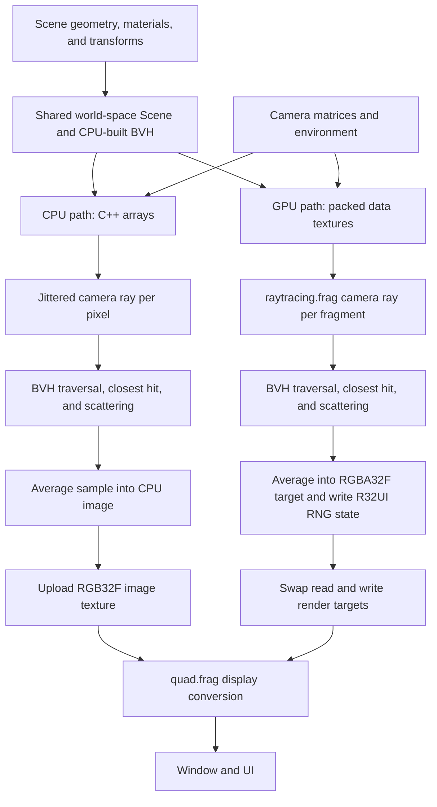

# Project 2: Ray Tracing

English | [简体中文](README-zh.md)

This assignment covers the implementation of a ray tracing pipeline in an undergraduate computer graphics course. The core algorithms include ray–sphere and ray–triangle intersection, axis-aligned bounding box tests, bounding volume hierarchy (BVH) traversal, and stochastic scattering for diffuse, metal, and dielectric materials.

The assignment requires separate CPU and GPU implementations. The CPU implementation uses C++, and the GPU implementation uses GLSL. Both implementations are validated individually and compared using the same scene, camera, materials, environment, resolution, and sample count. The interface supports switching between them at runtime.

The application provides three scenes, from three material-test spheres to a scene containing many spheres and three Lucy model instances. Each renderer progressively averages one new path sample per pixel on each rendered frame.


## Contents

- [1. Learning Objectives and Prerequisites](#1-learning-objectives-and-prerequisites)
- [2. Setup, Build, and Run](#2-setup-build-and-run)
- [3. Interface and Controls](#3-interface-and-controls)
- [4. Project Structure](#4-project-structure)
- [5. Rendering Pipeline and Data Conventions](#5-rendering-pipeline-and-data-conventions)
- [6. Assignment Tasks](#6-assignment-tasks)
- [7. Sampling, Materials, and Display](#7-sampling-materials-and-display)
- [8. Debugging and Validation](#8-debugging-and-validation)
- [9. Report and Submission Suggestions](#9-report-and-submission-suggestions)
- [10. Optional Extensions](#10-optional-extensions)
- [11. Troubleshooting](#11-troubleshooting)
- [12. Model Assets and Licensing](#12-model-assets-and-licensing)

## 1. Learning Objectives and Prerequisites

The learning objectives are:

1. Generate world-space camera rays from jittered pixel positions and explain the role of inverse projection and inverse view transforms.
2. Find the nearest valid sphere or triangle intersection, retaining consistent hit positions, normals, and material indices.
3. Use slab tests and an explicit traversal stack to accelerate intersection with a BVH.
4. Generate scattered rays for Lambertian, metal, and dielectric surfaces, including reflection, refraction, Fresnel reflectance, and total internal reflection.
5. Accumulate independent path samples over time and distinguish sampling noise from geometric or material errors.
6. Validate the CPU and GPU implementations separately, then compare their geometry, materials, convergence, and performance.

Prerequisites include vector operations, matrix transforms, parametric rays, quadratic equations, barycentric coordinates, reflection and refraction, probability densities, and basic Monte Carlo estimation. Programming prerequisites include C++ classes and containers, GLSL functions and `inout` parameters, texture sampling, and framebuffer attachments.

The framework provides window management, camera controls, OBJ loading, scene construction, BVH construction, random sampling helpers, progressive accumulation, and image presentation.

## 2. Setup, Build, and Run

### 2.1 Requirements

| Component | Requirement or purpose |
| --- | --- |
| Git | Obtain the repository and vcpkg |
| CMake | Version 3.20 or newer |
| C++ toolchain | C++20 support and a standard library that provides `std::format`; the Visual Studio 2022 C++ toolchain is suitable on Windows |
| Graphics environment | A driver and desktop environment capable of creating an OpenGL 4.1 Core context |
| vcpkg | Install third-party dependencies from the project manifest |

The dependencies in [`vcpkg.json`](vcpkg.json) are GLAD, GLFW, GLM, tinyobjloader, stb, and Dear ImGui. They provide OpenGL function loading, window management, math operations, OBJ parsing, image decoding, and the interactive UI, respectively.

Both paths require an OpenGL context. The CPU path uploads its accumulated image as a texture for display. Both renderers, the Lucy model, and all six environment images are initialized at startup, including when the initial scene only contains spheres.

Run all commands below from the **repository root**, which contains `base/`, `projects/`, and `screenshots/`. Keep the full repository structure: this project depends on shared code outside `projects/project2/`.

### 2.2 Windows: PowerShell and Visual Studio 2022

When installing Visual Studio, select the **Desktop development with C++** workload, including the corresponding MSVC toolchain and Windows SDK.

If you do not have vcpkg, run the following from the repository root:

```powershell
git clone https://github.com/microsoft/vcpkg.git vcpkg
.\vcpkg\bootstrap-vcpkg.bat
$vcpkgRoot = (Resolve-Path .\vcpkg).Path
```

If you already have vcpkg, set `$vcpkgRoot` to its actual location. Then configure, build, and run:

```powershell
cmake -S projects/project2 -B build/project2 -G "Visual Studio 17 2022" -A x64 "-DCMAKE_TOOLCHAIN_FILE=$vcpkgRoot/scripts/buildsystems/vcpkg.cmake"
cmake --build build/project2 --config Release --target ray_tracer
.\build\project2\Release\ray_tracer.exe
```

Configuration installs the manifest dependencies automatically through vcpkg. The initial configuration includes dependency downloads and compilation.

To debug in Visual Studio, open the generated `build/project2/ray_tracer.sln` and select `ray_tracer` as the startup project. A Debug build places the executable in the corresponding `Debug/` directory. Use Release for performance comparisons.

### 2.3 macOS / Linux: Terminal

Prepare a compiler and standard library with the required C++20 features, CMake, and the build tools required by your platform. Linux also needs the window-system development dependencies required by GLFW. If you already have vcpkg, replace the toolchain path below with your installation's path.

```sh
git clone https://github.com/microsoft/vcpkg.git vcpkg
./vcpkg/bootstrap-vcpkg.sh

cmake -S projects/project2 -B build/project2 \
  -DCMAKE_BUILD_TYPE=Release \
  -DCMAKE_TOOLCHAIN_FILE="$PWD/vcpkg/scripts/buildsystems/vcpkg.cmake"
cmake --build build/project2 --target ray_tracer --parallel
./build/project2/ray_tracer
```

These output paths assume a single-configuration generator. With a multi-configuration generator, specify `--config Release` and look for the executable in the corresponding configuration subdirectory. On macOS, the window code requests a forward-compatible OpenGL context.

### 2.4 Updating Code and Shaders

After editing C++, run the build command again. After editing a shader, follow the sequence **save → build → restart the application**.

Every build of `ray_tracer` runs the `ray_tracer_assets` target using [`cmake/sync_assets.cmake`](cmake/sync_assets.cmake). It populates an `assets/` directory beside the executable, copies models and environment images, and hard-links shaders to their source files when possible, with copying as a fallback. Rebuilding refreshes the links after editors replace source files on save.

Shader source files are located in `assets/shaders/` and load at application startup. Resource synchronization does not reload shaders in a running application. Assets are resolved relative to the executable, so moving it also requires its adjacent `assets/` directory.

## 3. Interface and Controls

The default window is `640 × 360`, the initial renderer is `GPU`, and the initial scene is `scene 1`. Both paths render at the physical framebuffer dimensions. The camera has a 60° vertical field of view and projection near/far parameters of `0.1` and `1000`.

| Control or display | Effect |
| --- | --- |
| `renderer`: `GPU` / `CPU` | Select the GLSL or C++ ray tracing implementation; reset accumulation in both |
| `switch scenes`: `scene 1` / `scene 2` / `scene 3` | Rebuild the shared scene and BVH, restore that scene's camera, and reset accumulation |
| `W` / `S` | Move the camera forward / backward |
| `A` / `D` | Move the camera left / right |
| `Q` / `E` | Move the camera up / down along its local up axis |
| `samples` in the window title | Completed full-image samples per pixel for the active renderer |
| `Esc` | Exit the application |

Camera translation uses a speed of 5 world units per second. Camera movement resets both accumulators. There are no mouse-look, exposure, sample-limit, or bounce-limit controls in the UI. The default window cannot be resized by dragging; change its initial dimensions in [`src/main.cpp`](src/main.cpp).

| Scene | Contents | Initial camera |
| --- | --- | --- |
| `scene 1` | Three spheres: a central dielectric, a metal at positive X, and a Lambertian at negative X | Position `(0, 0, 12)`, looking at the origin |
| `scene 2` | A large ground sphere, many small spheres, and three larger material-test spheres | Position approximately `(12.486, 1.926, 1.318)`, looking at `(0, 3, 0)` |
| `scene 3` | Scene 2's spheres plus three transformed Lucy instances with dielectric, metal, and Lambertian materials | Same initial camera as scene 2 |

The small spheres and their materials are generated once during startup. CPU and GPU share the same scene instance within a run. Begin validation with scene 1, then use scenes 2 and 3 to test BVH traversal and triangle intersections. Scene initialization prints primitive, model, and BVH statistics to the terminal.

## 4. Project Structure

```text
repository root/
├── base/                         Window, camera, transforms, and OpenGL wrappers
├── screenshots/project2.png      Scene 3 example
└── projects/project2/
    ├── CMakeLists.txt            Build entry point
    ├── vcpkg.json                Dependency manifest
    ├── cmake/sync_assets.cmake   Runtime asset synchronization
    ├── docs/images/              README illustrations
    ├── include/                  Geometry, scene, material, and renderer types
    ├── src/                      C++ implementations
    └── assets/
        ├── models/lucy.obj       Triangle mesh
        ├── skyboxrt/             Six environment images
        └── shaders/              Ray tracing and presentation shaders
```

| File | Responsibility |
| --- | --- |
| [`src/ray_tracer_app.cpp`](src/ray_tracer_app.cpp) | Scene selection, camera input, renderer selection, presentation, and UI |
| [`include/ray_tracer.h`](include/ray_tracer.h), [`src/ray_tracer.cpp`](src/ray_tracer.cpp) | Common renderer interface, dimensions, scene/environment ownership, and sample count |
| [`src/cpu_ray_tracer.cpp`](src/cpu_ray_tracer.cpp) | CPU intersections, BVH traversal, material scattering, path sampling, and accumulation |
| [`src/gpu_ray_tracer.cpp`](src/gpu_ray_tracer.cpp) | Scene packing, data textures, ping-pong render targets, and GPU draw scheduling |
| [`assets/shaders/raytracing.frag`](assets/shaders/raytracing.frag) | GPU intersections, traversal, scattering, path sampling, and accumulation |
| [`assets/shaders/quad.vert`](assets/shaders/quad.vert) | Full-screen triangle for tracing and presentation |
| [`assets/shaders/quad.frag`](assets/shaders/quad.frag) | Display conversion for the accumulated image |
| [`include/scene.h`](include/scene.h), [`src/scene.cpp`](src/scene.cpp) | World-space scene assembly, material assignment, BVH construction, and primitive reordering |
| [`include/bvh.h`](include/bvh.h), [`src/bvh.cpp`](src/bvh.cpp) | Flat BVH nodes and bucket-based construction |
| [`include/ray.h`](include/ray.h), [`include/aabb.h`](include/aabb.h) | Ray representation and bounding-box utilities |
| [`include/primitive.h`](include/primitive.h), [`include/sphere.h`](include/sphere.h), [`include/triangle.h`](include/triangle.h), [`include/vertex.h`](include/vertex.h) | Geometry types and shape/material indices |
| [`include/material.h`](include/material.h) | Material type, index of refraction, fuzz, and albedo |
| [`src/model.cpp`](src/model.cpp) | OBJ parsing, vertex indexing, triangulation, and missing-normal generation |
| [`src/skybox.cpp`](src/skybox.cpp) | Environment image loading, CPU cubemap sampling, and GPU cubemap creation |
| [`include/random.h`](include/random.h) | Random helpers used for procedural scene construction |

Path sampling uses per-pixel RNG functions in `cpu_ray_tracer.cpp` and `raytracing.frag`; these are separate from the scene-generation helpers in `random.h`.

## 5. Rendering Pipeline and Data Conventions

### 5.1 How the Two Paths Correspond



The GPU implementation uses a full-screen triangle and a fragment shader. Ray–geometry intersections and visibility are computed inside the shader. Scene geometry is supplied as data textures; it is not drawn through a triangle-mesh rasterization pass. Both renderers use the same BVH, constructed on the CPU when the scene changes.

### 5.2 Rays and Coordinate Spaces

The project uses column vectors. Scene assembly transforms model vertices into world space before BVH construction. Normals use the inverse-transpose transform. Rays, hit positions, and surface normals used for tracing are in world space.

```text
ray(t)         = origin + t * direction
cameraToWorld  = inverse(view)
screenToRaster = scale(width/2, height/2, 1) * translate(1, 1, 0)
rasterToCamera = inverse(projection) * inverse(screenToRaster)
```

Pixel `(x, y)` is sampled at `(x + u, y + v)`, where `u` and `v` are random values in `[0, 1)`. Raster coordinates start at the lower left. The GPU subtracts `0.5` from `gl_FragCoord.xy` before adding this jitter, matching the CPU's integer pixel origin.

Ray generation transforms the camera origin with homogeneous `w = 1` and directions with `w = 0`, then normalizes each direction. Its inverse-projection step uses the XYZ components at raster Z = 0 as a direction; it does not perform perspective division on that vector. Camera near/far projection parameters do not directly clip ray hits. Intersections use the ray's own valid interval.

| Data | Convention |
| --- | --- |
| `Ray::direction` | Unit length; the sphere intersection formula assumes this |
| `Ray::tMax` | Current closest hit distance; initially the maximum finite float and reset after scattering |
| Valid primitive hit | `epsilon < t < ray.tMax`, with `epsilon = 1e-3` |
| Sphere normal | Outward unit vector from center to hit point |
| Triangle normal | Normalized barycentric interpolation of vertex normals, with a geometric-normal fallback |
| Triangle sides | Both sides are tested; a negative determinant alone does not reject the triangle |
| Trace depth | At most 16 iterations per sampled path |

### 5.3 BVH Representation

The BVH root is node `0`. Each node contains an AABB and two signed fields:

| Node kind | `first` | `second` |
| --- | --- | --- |
| Interior: `second >= 0` | Left child node index | Right child node index |
| Leaf: `second < 0` | First entry in the reordered primitive array | Negative primitive count |

A leaf's primitives occupy `[first, first - second)`. Each `Primitive` then identifies a sphere or triangle through `shapeIndex` and a material through `materialIndex`. A primitive index, a shape index, and a material index belong to different arrays.

[`src/bvh.cpp`](src/bvh.cpp) selects the largest centroid extent, compares 12-bucket surface-area split costs, and partitions primitive indices. A leaf is produced for a single primitive, coincident centroids on the selected axis, or a depth of 64. Scene assembly reorders the primitive records to match leaf ranges. Both traversal implementations use a 64-entry explicit stack.

### 5.4 GPU Data Layout

[`GpuRayTracer::uploadSceneData()`](src/gpu_ray_tracer.cpp) explicitly packs scene records into 2D textures with a width of 2048 texels and sufficient padded rows. Shader accessors derive coordinates from the actual texture dimensions. This width is independent of the rendering resolution.

| Texture uniform | Format | Texels per record | Packed fields |
| --- | --- | --- | --- |
| `sphereBuffer` | `RGBA32F` | 1 | Center XYZ, radius |
| `vertexBuffer` | `RGBA32F` | 2 | `(position.xyz, normal.x)`, `(normal.yz, texCoord.xy)` |
| `triangleIndexBuffer` | `RGB32I` | 1 | Three vertex indices |
| `materialBuffer` | `RGB32F` | 2 | `(type, ior, fuzz)`, `albedo.xyz` |
| `primitiveBuffer` | `RGB32I` | 1 | Type, shape index, material index |
| `bvh` | `RGBA32F` | 2 | `(min.xyz, max.x)`, `(max.yz, first, second)` |

Integer textures use signed integer samplers; floating-point data textures use floating-point samplers. Scene data uses nearest filtering. BVH indices are stored as floats and decoded to integers in the shader, so extensions to very large scenes must account for float integer precision. C++ packing and GLSL decoding must be changed together.

## 6. Assignment Tasks

### 6.1 Scope

The assignment consists of **Part I: CPU Ray Tracer** and **Part II: GPU Ray Tracer**. Both parts are required. Each implementation performs its own intersection and material-scattering calculations and produces its own progressively sampled image.

Task locations are identified by `TODO` markers. The framework supplies OBJ and environment loading, scene assembly, BVH construction, camera-ray generation, random sampling helpers, accumulation, and presentation. CPU traversal and primitive dispatch are supplied; their GPU counterparts are assignment tasks.

Sections 6.2 and 6.3 list the tasks for each implementation. Sections 6.4–6.9 describe the algorithms and their invariants.

### 6.2 Part I: CPU Ray Tracer (Required)

Implement the CPU tasks in [`src/cpu_ray_tracer.cpp`](src/cpu_ray_tracer.cpp):

| Task | Location | Required work |
| --- | --- | --- |
| CPU-1. Ray–AABB test | `intersectAABB()` | Intersect the three slab intervals, including rays parallel to a slab |
| CPU-2. Ray–sphere intersection | `intersectSphere()` | Select the nearest valid root and update `ray.tMax`, position, and outward normal |
| CPU-3. Ray–triangle intersection | `intersectTriangle()` | Solve for distance and barycentric coordinates, reject invalid hits, and interpolate the normal |
| CPU-4. Lambertian scattering | `lambertianScatterFunction()` | Transform a cosine-weighted hemisphere sample to world space and update the ray |
| CPU-5. Metal scattering | `metalScatterFunction()` | Reflect the incident ray, perturb it using `fuzz`, and reject directions below the surface |
| CPU-6. Dielectric scattering | `dielectricScatterFunction()` | Handle entry/exit, Fresnel reflection, refraction, total internal reflection, and origin offsets |
| CPU-7. Environment contribution | Miss branch in `trace()` | Sample the skybox along the escaping ray and multiply it by the accumulated path throughput |

The `intersectAABB()` task is the local function in `cpu_ray_tracer.cpp`; changing only `AABB::intersects()` in the header does not replace that task. `CpuRayTracer::intersect()` already supplies BVH traversal, and `intersectPrimitive()` supplies geometry dispatch.

**Part I validation:** Select `CPU`. Verify scene 1's three materials, then check the denser sphere scene and Lucy geometry. Record results and sample counts independently of the GPU implementation.

### 6.3 Part II: GPU Ray Tracer (Required)

Implement the GPU tasks in [`assets/shaders/raytracing.frag`](assets/shaders/raytracing.frag):

| Task | Location | Required work |
| --- | --- | --- |
| GPU-1. BVH traversal | `intersect()` | Traverse from node 0 with an explicit stack and retain the closest primitive hit |
| GPU-2. Ray–AABB test | `intersectAABB()` | Intersect slab intervals using the current `ray.tMax` |
| GPU-3. Primitive dispatch | `intersectPrimitive()` | Decode the selected shape, call its intersection routine, and fill the hit/material record |
| GPU-4. Ray–sphere intersection | `intersectSphere()` | Select the nearest valid root and update distance, position, and normal |
| GPU-5. Ray–triangle intersection | `intersectTriangle()` | Test barycentric coordinates and distance, then compute the hit normal |
| GPU-6. Lambertian scattering | `lambertianScatterFunction()` | Generate and transform the diffuse scattering direction |
| GPU-7. Metal scattering | `metalScatterFunction()` | Compute a fuzz-perturbed reflection and update the ray |
| GPU-8. Dielectric scattering | `dielectricScatterFunction()` | Choose reflection or refraction with consistent side tests and origin offsets |
| GPU-9. Environment contribution | Miss branch in `trace()` | Sample `sky` in the escaping direction and multiply by path throughput |

The shader provides camera-ray generation, sampling helpers, scene-data accessors, the tracing loop, and progressive averaging. [`src/gpu_ray_tracer.cpp`](src/gpu_ray_tracer.cpp) supplies data uploads, texture binding, and render-target scheduling.

**Part II validation:** Select `GPU` and run the same scene, intersection, and material checks as for Part I. Compare outputs at a fixed camera and equal completed samples per pixel.

### 6.4 Algorithm Notes: Closest-Hit Queries and Slab Tests

Every successful primitive test shortens `ray.tMax`. A later candidate may replace the hit only if its distance is positive, exceeds the self-intersection threshold, and is closer than the current hit. Update the distance, position, normal, and material record together. Failed tests leave the current hit intact.

For each AABB axis, compute the two plane intersections, order them, and intersect that interval with the current interval. Begin with `[0, ray.tMax]`. If the resulting near value exceeds the far value, the ray misses the box.

When the direction component is approximately zero, test whether the origin lies within that axis's slab instead of dividing by the component. This also covers rays starting inside the box. A bounding-box hit is only a candidate for traversal; the closest primitive test determines surface visibility.

### 6.5 Algorithm Notes: Sphere and Triangle Intersections

For a sphere centered at `c` with radius `r`, let `o` be the ray origin and `d` its unit direction:

```text
offset = o - c
halfB  = dot(offset, d)
C      = dot(offset, offset) - r*r
D      = halfB*halfB - C
t      = -halfB ± sqrt(D)
```

Reject a negative discriminant. Test the smaller root first, then the larger root if the first is too close or behind the ray origin. This second root is required for rays originating inside a sphere. Retain the closest root within the valid interval, and compute `normal = normalize(hitPosition - c)`.

For triangles, use an edge-based intersection such as Möller–Trumbore. Reject near-zero determinants and retain hits satisfying:

```text
beta >= 0
gamma >= 0
beta + gamma <= 1
epsilon < t < ray.tMax
```

The barycentric weights are `(1 - beta - gamma, beta, gamma)`. Apply them to the world-space vertex normals and normalize the result. If the interpolated vector is zero, the implementation falls back to the triangle's geometric normal. Degenerate triangles must be rejected before normalizing a zero geometric normal. UVs are carried in the vertex data, but the current tracing materials do not sample surface textures.

### 6.6 Algorithm Notes: BVH Traversal

Begin at root node 0. Test each node's bounds against the ray's current interval. For an interior node that passes, push one child index and visit the other. For a leaf, test every primitive in its contiguous range. After a miss or a completed leaf, pop the next node until the stack is empty.

Finding one intersection does not complete a closest-hit query: other branches may contain a nearer surface. Keeping the shortened `ray.tMax` also allows subsequent box tests to reject regions beyond that surface.

The GPU traversal uses the node count to bound visits and checks node indices, leaf ranges, and stack capacity. Preserve these bounds when implementing traversal. Construction caps tree depth to match the 64-entry stacks; changing the builder or scene format requires checking both traversal implementations.

### 6.7 Algorithm Notes: Diffuse and Metal Scattering

For a Lambertian surface, sample the local hemisphere with a cosine-weighted distribution and transform the sample using an orthonormal frame around the surface normal. Normalize the outgoing world-space direction and offset the origin along the normal.

With a Lambertian BRDF `albedo / pi` and sampling density `cos(theta) / pi`, the BRDF, cosine, and PDF factors reduce to `albedo`. The provided tracing loop applies that albedo to the path throughput; do not multiply it a second time in the scattering function.

For a metal, start from `reflect(incidentDirection, normal)`. The supplied convention adds `fuzz` times a cosine-weighted sample oriented around that reflected direction, then normalizes. A zero fuzz value gives a mirror direction. Return failure when the perturbed direction points below the surface. This is a simplified rough-metal model rather than a microfacet BRDF.

For both materials, restore `ray.tMax` to the maximum finite float after scattering so the next segment is not limited by the previous hit distance.

### 6.8 Algorithm Notes: Dielectric Scattering

Use the sign of `dot(incidentDirection, outwardNormal)` to determine whether the ray enters or leaves the material. Choose a facing normal opposite the incident direction, and use a refraction ratio of `1 / ior` on entry or `ior` on exit, assuming the surrounding medium has index 1.

Schlick's approximation supplies a reflection probability:

```text
R0   = ((1 - ior) / (1 + ior))^2
R(c) = R0 + (1 - R0) * (1 - c)^5
```

The supplied helpers clamp the cosine input to `[0, 1]`. The CPU/GPU convention uses `-dot(d, n)` on entry and `ior * dot(d, n)` on exit as that input. Use the same convention for comparisons.

Select reflection when total internal reflection makes refraction impossible, or when a random sample chooses the Fresnel reflection branch. Otherwise, select refraction. Reflection offsets the new origin toward the incident medium; refraction offsets it across the surface. Normalize the outgoing direction and reset `tMax`.

The model assumes an air/material boundary and multiplies albedo once per hit. Nested media, absorption, and wavelength-dependent refraction are extension topics.

### 6.9 Algorithm Notes: Environment and Path Termination

The tracing loop starts throughput at `(1, 1, 1)` and multiplies it by the material albedo at each hit. When a ray misses all geometry, return throughput times the environment color sampled along its outgoing direction.

The provided loop permits 16 iterations. If it exhausts the limit or a diffuse/metal scattering function returns failure, it returns the current throughput. This termination convention affects comparisons and differs from estimating only environment contributions. Keep the CPU/GPU convention consistent, and describe any alternative termination rule in the report.

## 7. Sampling, Materials, and Display

### 7.1 Progressive Sampling and Reset Behavior

Each active-renderer call traces one jittered path per pixel across the full framebuffer. If the old image averages `N` samples and the new sample is `sample`, both implementations use:

```text
newAverage = oldAverage + (sample - oldAverage) / (N + 1)
```

The CPU stores this average in a `std::vector<glm::vec3>` and uploads it to an `RGB32F` texture. The GPU alternates two framebuffers, each containing an `RGBA32F` average and an `R32UI` RNG state. The previous average/state are read while the next pair are written, then the roles are swapped. The first GPU sample after reset overwrites the previous image instead of averaging it in.

Both paths use per-pixel xorshift RNG state, initially seeded with `1664525 * pixelIndex + 1013904223` in unsigned 32-bit arithmetic. Random values advance for subpixel jitter and scattering. A renderer/scene switch or camera movement resets the sample count; CPU averages are cleared. These resets do not rewind the RNG streams. Extent changes recreate their resources and seeds.

Switching paths therefore does not guarantee identical random samples. Compare the same scene, camera, and sample count, and use controlled RNG states for numerical tests. A title count of `N` means `N` paths have been completed for every pixel; it is not a global count of rays or bounces.

### 7.2 Materials and Environment

| Material | Fields used | Scattering behavior |
| --- | --- | --- |
| Lambertian: type 0 | `albedo` | Cosine-weighted diffuse scattering |
| Metal: type 1 | `albedo`, `fuzz` | Reflection plus a stochastic directional perturbation |
| Dielectric: type 2 | `albedo`, `ior` | Stochastic Fresnel reflection or refraction, including total internal reflection |

The environment supplies illumination to escaping paths. The current tracer has no emissive geometry, explicit light sampling, direct-light shadow-ray pass, or surface-texture shading. OBJ material-library data does not drive shading; scene construction assigns one `Material` to each model instance and one to each sphere.

Cubemap faces are loaded in this order: `right`, `left`, `top`, `bottom`, `front`, `back`, corresponding to `+X`, `-X`, `+Y`, `-Y`, `+Z`, `-Z`. The CPU selects the dominant direction axis and bilinearly samples the chosen face with clamped edge coordinates. The GPU samples a cubemap with linear filtering and clamp-to-edge addressing. Filtering near face boundaries can differ.

Environment images are decoded as 8-bit RGB. The CPU divides by 255, and the GPU uses an `RGB8` cubemap; there is no explicit sRGB-to-linear decoding step in either path. Record this convention when changing environment assets or analyzing brightness.

### 7.3 Final Display

Both paths use [`quad.frag`](assets/shaders/quad.frag) to convert the accumulated color for display:

```text
displayColor = pow(max(averageColor, 0), 1 / 2.2)
```

There is no tone-mapping or exposure stage. Values above the display range can saturate. Numerical comparisons should use averages before this conversion, with matched sample counts and color conventions; screenshot values already include display conversion.

## 8. Debugging and Validation

### 8.1 Debug by Stage

Begin with scene 1 and a fixed camera. Validate camera rays → sphere hits → nearest distance → normals → material identity → scattering → environment → accumulation. Add scene 2 for dense BVH traversal and scene 3 for triangle intersections and transformed normals.

Useful temporary visualizations include normalized ray direction, hit distance, `normal * 0.5 + 0.5`, material index, and BVH visit count. Test individual ray queries with known origins/directions before interpreting a noisy final image. A brute-force primitive loop provides a reference for checking BVH closest-hit results.

### 8.2 Suggested Tests

Construct the following tests and run them separately on both implementations. Record the input, expected result, observed result, and any CPU/GPU difference.

| Test | Main check | Expected result |
| --- | --- | --- |
| Ray through a sphere center; tangent ray; miss | Quadratic roots | Correct distance and outward normal; tangent accepted if within the interval |
| Ray starting inside a sphere | Root selection | Positive exit root retained |
| Two surfaces at different distances, with primitive order reversed | Closest-hit invariant | Same nearest surface and material |
| Ray parallel to an AABB slab, inside and outside it | Parallel-axis handling | No division by zero; correct interval rejection |
| Ray starting inside an AABB | Initial interval | Valid forward traversal |
| Triangle interior, edge, exterior, and reversed winding | Barycentric tests and sidedness | Interior/edge hits retained; exterior rejected; both sides tested |
| Collinear triangle or near-parallel ray | Degenerate handling | No invalid hit, division by zero, or NaN normal |
| BVH versus brute-force intersection | Traversal and leaf ranges | Same hit/miss, nearest distance, and material |
| Metal with fuzz 0, then increasing fuzz | Reflection and perturbation | Mirror direction at 0; broader reflection at larger fuzz |
| Entering/exiting glass and a ray above the critical angle | Refraction, normal side, total internal reflection | Correct side offsets and reflection when refraction is impossible |
| Escaping rays in six axis directions | Cubemap order and orientation | Matching face colors and orientation |
| Fixed camera over increasing sample counts | Running average and RNG progression | Sample count grows and stochastic noise generally decreases |
| Move camera or switch scene/renderer | Accumulation reset | Old and new views are not blended |

Monte Carlo convergence does not guarantee each pixel becomes less noisy at every sample. Compare equal-sample images and repeated measurements rather than requiring exact screenshot equality. Wrong silhouettes, persistent material errors, unstable self-intersections, and old-view ghosting require further debugging.

### 8.3 Performance Records

Keep Release configuration, framebuffer resolution, scene, camera, environment, maximum depth, and sample count fixed. Record the CPU, GPU, compiler, time per full-image sample, and time to reach a specified sample count. The current CPU implementation is a serial full-image loop; the GPU shades pixels in parallel.

Vertical synchronization is disabled by default. The title shows samples, not FPS. Frame time also includes UI, texture upload, presentation, and driver work, while scene changes separately incur BVH construction and data uploads. If reporting only tracing time, state the measured interval and GPU synchronization method. Compare performance only after correctness checks pass.

## 9. Report and Submission Suggestions

The report should include:

1. **Environment:** OS, CPU/GPU, compiler, build configuration, and framebuffer resolution.
2. **Completion:** Separate lists for Part I (CPU-1–CPU-7) and Part II (GPU-1–GPU-9), including modified files and known issues.
3. **Algorithms:** Explain nearest-hit updates, slab tests, barycentric intersection, BVH traversal, and the three scattering rules in your own words.
4. **Results:** CPU/GPU images of all three scenes at matching camera poses and sample counts, plus targeted intersection, material, and reset tests.
5. **Analysis:** Discuss noise, convergence, floating-point differences, origin offsets, trace-depth termination, and any observed CPU/GPU discrepancies.
6. **Performance and extensions:** Provide measurements under equal conditions and document changes to the framework or rendering model. Attribute external code, references, assets, and tool assistance with their scope of use.

Questions for algorithm analysis:

- Why does every successful primitive test shorten `ray.tMax`, and why must scattering restore it?
- Why does a ray starting inside a sphere require the second quadratic root?
- Why does finding one BVH hit not finish a closest-hit query?
- How does cosine-weighted sampling reduce the Lambertian throughput update to albedo?
- How do reflection and refraction determine opposite origin-offset directions?
- What happens if old samples are retained after moving the camera?
- How do the provided finite-depth termination and environment color-space conventions affect results?

Check reproducibility with a clean build directory, complete runtime assets, documented sample counts, and agreement among the submitted source, build commands, and report. Keep generated build output, dependency checkouts, and IDE caches separate from source submissions.

## 10. Optional Extensions

- **Improve traversal:** Order children by ray entry distance, compare split strategies, or measure BVH visits while preserving closest-hit results.
- **Optimize CPU rendering:** Add tiles, multithreading, or SIMD; retain independent per-pixel RNG and deterministic ownership of accumulation writes.
- **Extend light transport:** Add explicit emitters, next-event estimation, multiple importance sampling, or Russian roulette with the corresponding estimator changes.
- **Extend materials:** Add a microfacet model, absorption, texture mapping, or a medium stack for nested dielectrics.
- **Improve display and sampling:** Add linearized environment loading, HDR environments, tone mapping, exposure, adaptive sampling, or a convergence display.
- **Improve reproducibility and interaction:** Add a fixed-seed reset, sample/bounce limits, image export, timing controls, or mouse-look with correct accumulation invalidation.

Each extension should state its model and validation criteria. Changes to sampling distributions require checking their PDFs and throughput weights, and changes to scene layout require updating both C++ packing and GLSL decoding.

## 11. Troubleshooting

| Symptom | Checks |
| --- | --- |
| Missing `glad`, `glfw3`, `glm`, `imgui`, or `tinyobjloader` | Pass the correct vcpkg toolchain on initial configuration; use a new build directory when changing toolchains or generators |
| `std::format` fails to compile | Check both the selected compiler and its standard library; requesting C++20 alone is insufficient |
| Source files or `base/` cannot be found | Keep the complete repository and run the documented commands from its root |
| Dependency installation fails | Inspect CMake/vcpkg logs to distinguish network, platform development-package, and compiler failures |
| OpenGL/GLFW initialization fails | Check driver support for an OpenGL 4.1 Core context in the current desktop environment |
| Missing Lucy model or skybox at startup | Check `assets/models/lucy.obj` and all six `assets/skyboxrt/` images beside the executable; they load even for scene 1 |
| Shader compilation or linking fails | Inspect terminal diagnostics, GLSL 4.10 syntax, sampler types, and framebuffer outputs; GPU shaders initialize even when testing CPU code |
| Shader edits have no effect | Save source files, rebuild `ray_tracer` to synchronize runtime assets, and restart the application |
| Spheres work but Lucy is missing | Check triangle indices, two-texel vertex decoding, barycentric tests, and instance transforms |
| Wrong material or isolated geometry | Distinguish primitive, shape, and material indices; verify reordered leaf ranges and signed `second` values |
| BVH rendering differs from brute force | Check node bounds, child indices, the stack, and shortened `ray.tMax` |
| Dark spots, acne, or glass artifacts | Check origin offsets, direction normalization, inside/outside classification, and total internal reflection |
| Persistent noisy patterns or no convergence | Ensure RNG state advances and the running-average weight uses completed samples rather than frame time |
| Old-view ghosting | Reset accumulation whenever camera, scene, resolution, or rendering parameters change |
| CPU interaction is slow | Use Release, start with scene 1, and account for serial tracing across the full framebuffer before each UI update |
| CPU/GPU images differ | Match camera and samples first, then inspect ray generation, scene decoding, normals, scattering, RNG consumption, and cubemap boundaries |

Exceptions are printed to standard error. Run from a terminal to retain diagnostics if the application exits during startup.

## 12. Model Assets and Licensing

The triangle model is [`assets/models/lucy.obj`](assets/models/lucy.obj). The environment consists of six images in [`assets/skyboxrt/`](assets/skyboxrt/). Model transforms, scene materials, and cubemap face order are specified in `ray_tracer_app.cpp`.

The repository's software license is provided in [`../../LICENSE`](../../LICENSE). The Project 2 asset directories do not include separate model or environment-image license files. Record the source, attribution, and applicable terms for assets used in reports or redistributed submissions; the software license alone does not establish third-party asset permissions.
