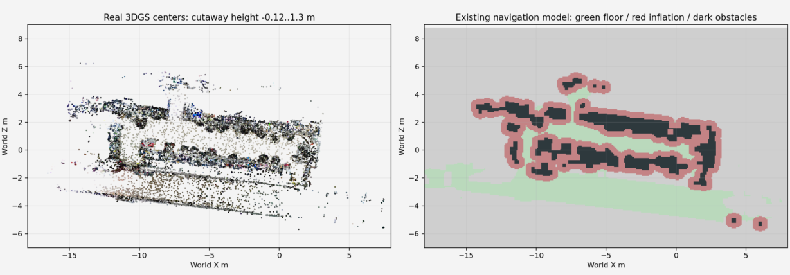
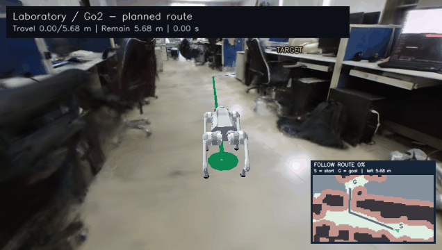
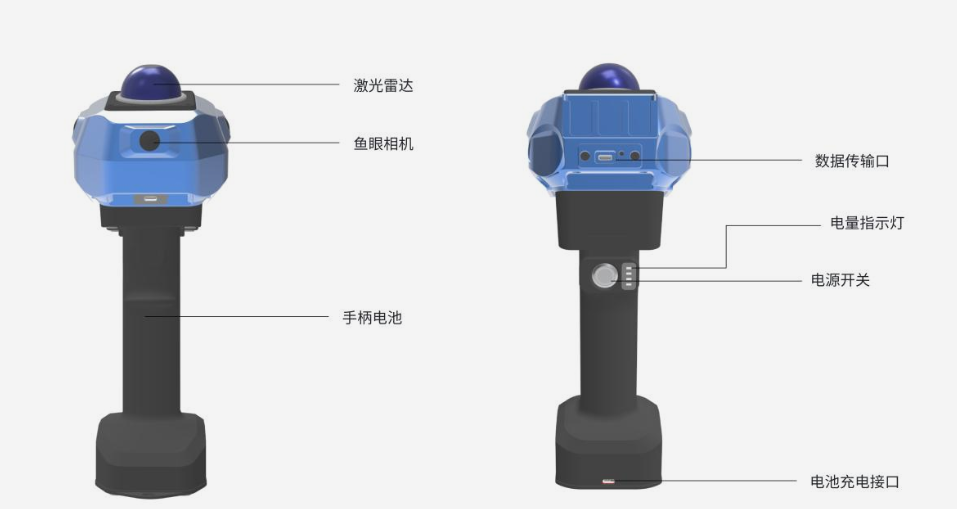

# Project 4: 3DGS Navigation

English | [简体中文](README-zh.md)

## Objective

Collect data from and reconstruct a real environment. Add a robot dog, goal, and obstacles to the 3D Gaussian Splatting (3D-GS) scene. Write a program that generates multiple candidate trajectories, selects one, and simulates the robot moving around obstacles to reach the goal. The navigation simulation must be runnable and reproducible.

## Basic requirements

- **Scene reconstruction:** Capture data with course equipment or another suitable device, investigate a public 3D-GS method, reconstruct the scene, and load the result into your own simulation or visualization program.
- **Scene configuration:** Write scripts to place the robot model, start, goal, and obstacles. Support configuration changes through parameters or interaction. Include at least one case where an obstacle blocks the straight line from start to goal.
- **Trajectory planning:** In a test setting with a feasible route, automatically generate at least three visibly different collision-free candidate trajectories. Show them, compare metrics such as length and safety clearance, and explain the choice of the selected route.
- **Motion execution:** Write logic that continuously updates the robot's position and orientation as it follows the selected trajectory around obstacles to the goal. Define an arrival test that accounts for robot size. Merely drawing a route or playing a prerecorded animation is insufficient.
- **Testing and analysis:** Test at least three configurations with different starts, goals, or obstacle layouts. Replan after changing the configuration. Record planning time, route length, arrival error, and collisions, then analyze the main problems and possible improvements.

## Advanced requirements

The basic task may use planar motion, a known robot pose, and manually marked traversable areas. Simplified collision geometry may represent the main scene obstacles and any added obstacles; keep the map, robot, and reconstructed-scene coordinates consistent. Motion may be simulated by updating position and orientation. Robot gait control and full SLAM are not required.

You may use public reconstruction code, rendering tools, and existing robot models. The basic task requires your own core path-planning and trajectory-execution logic. Advanced directions include automatic map creation, full mapping and navigation, and dynamic obstacle avoidance; open-source code or an existing navigation framework may be used. If you use such a framework, identify the modules you developed or improved and provide validation results. Merely running an existing demonstration does not complete the assignment.

## Tool selection

Data may be captured with the course-provided Liuxing Technology scanner or another device appropriate to the task. The reconstruction must use data that you collected in a real environment. A public dataset, simulated data, or a ready-made scene supplied by someone else cannot replace it.

## Submission

Submit a description of the captured data, the reconstructed model, your scripts and code, configuration and run instructions, and a navigation demonstration video. A four-to-six-page experimental report is recommended. The video should show scene configuration, multiple candidate trajectories, and the robot executing its route. The report should explain the algorithm choice, test results, original work, and team responsibilities.

## Task examples

### 1. Scene projection and navigation map

   
  <em>Figure 1: Laboratory scene projection (left) and navigation grid map (right)</em>

### 2. Navigation planning demonstration

   
  <em>Figure 2: Navigation planning demo</em>

### 3. Capture device

   
  <em>Figure 3: Capture device example — Q9000</em>

